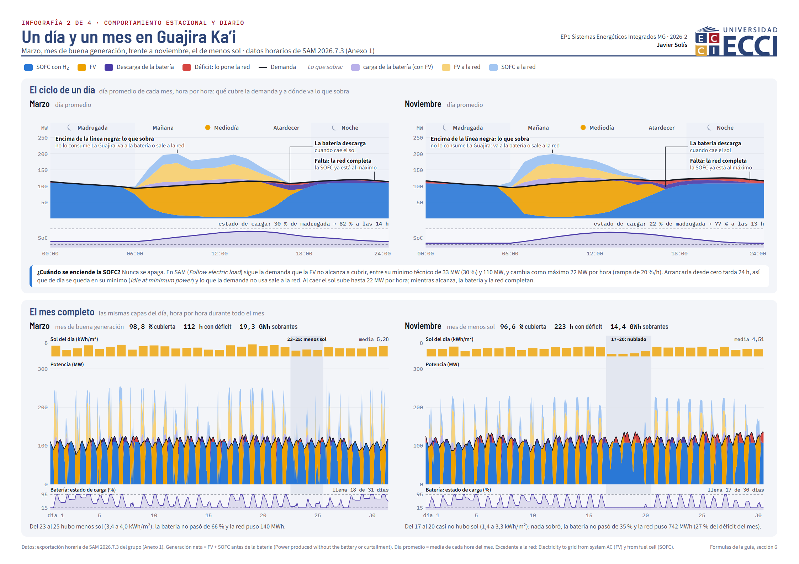
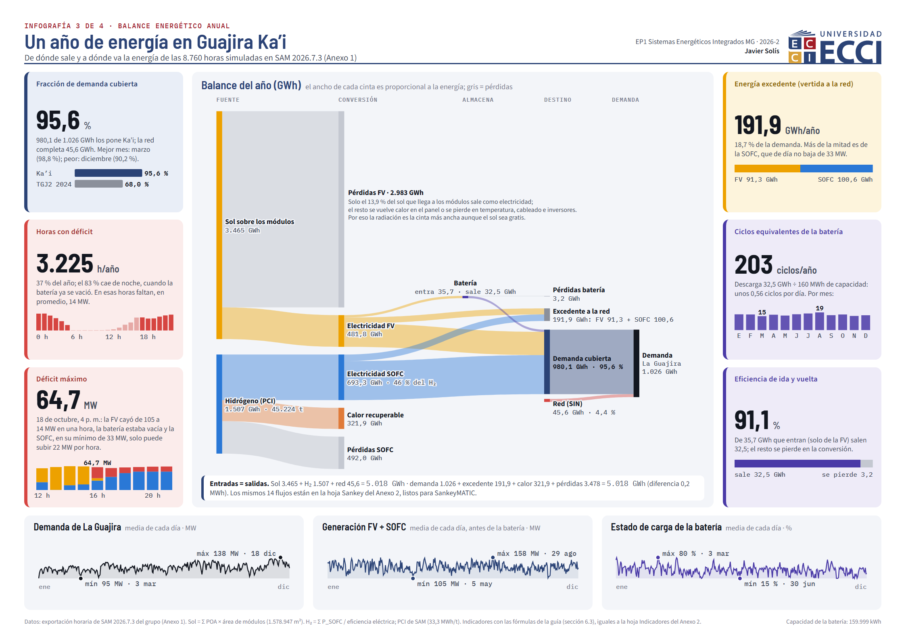
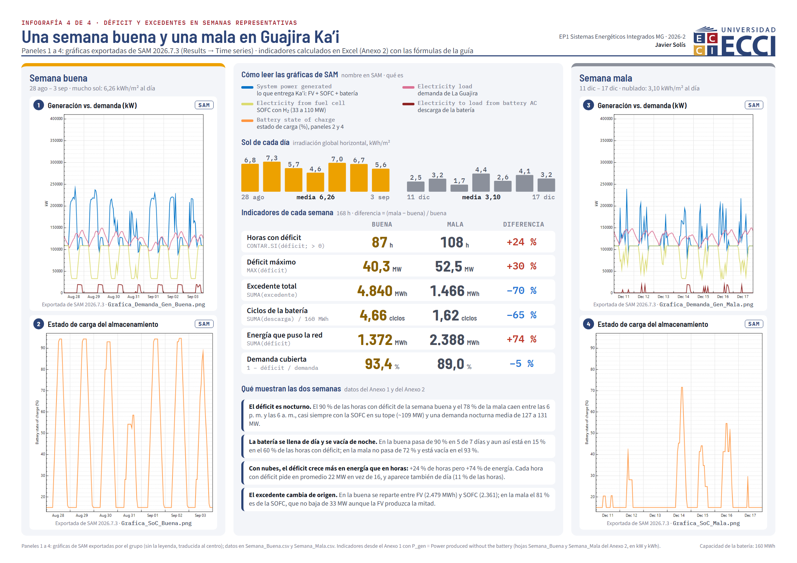
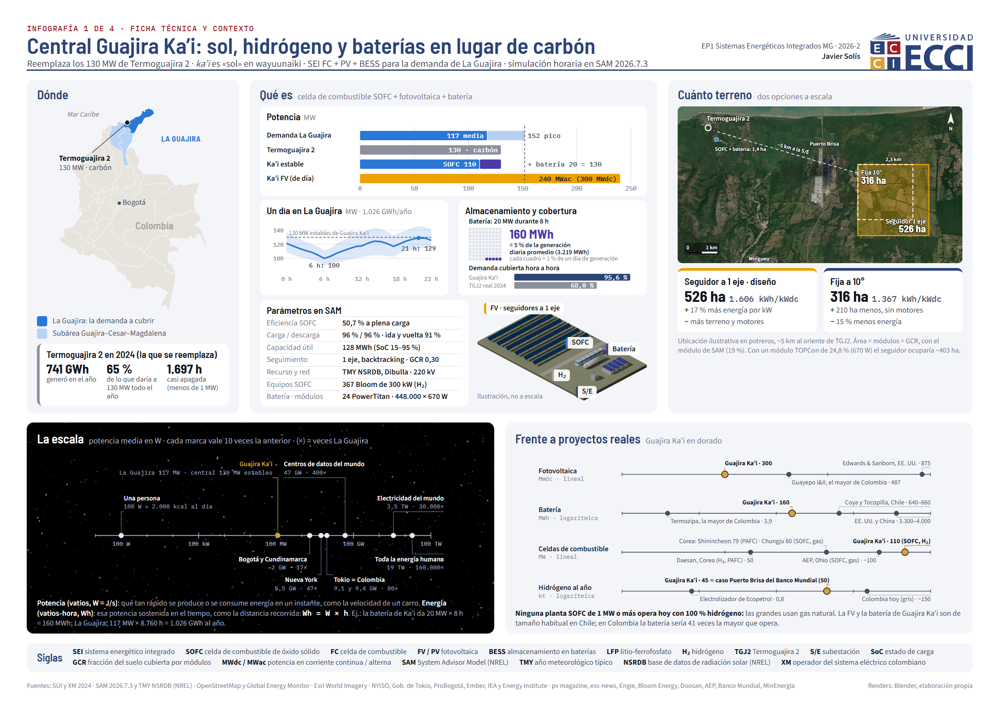
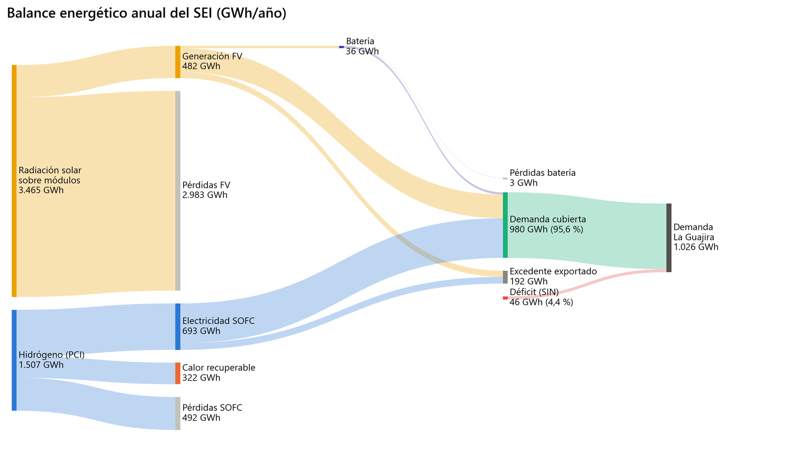

# Replacing Termoguajira 2 with a hydrogen fuel cell, solar photovoltaics and batteries

Characterization of the coal unit Termoguajira 2 (La Guajira, Colombia), an hourly demand profile for the whole department, and a System Advisor Model simulation of a hydrogen, solar and storage system that replaces it, with a scripted sweep of 2,271 configurations.


*Infographic 1 of 4: technical sheet and context of the proposed plant, named "Guajira Ka'i" in the project. Content in Spanish. Satellite imagery: Esri World Imagery. [PDF version](docs/infographics/01-technical-sheet-and-context.pdf). The other three infographics are in the [gallery](#infographics) below.*

## Problem / context

Termoguajira 2 (code TGJ2 at XM, the Colombian grid operator) is a 130 MW net effective capacity coal-fired steam unit, in operation since 1987 in Mingueo (Dibulla) and connected to the 220 kV Termoguajira substation. The national government has already announced its transformation (Decree 1276 of 2023). The course project asks two questions, to be answered with public data and an hourly simulation:

1. **How large is the unit compared with the demand of La Guajira?** First term: technical data from XM's Paratec viewer (operator of the National Interconnected System, SIN) and billed energy by user type from the O3 tool of the Single Information System (SUI) of the Superintendence of Residential Public Utilities. Report: [`docs/informe-corte-1.md`](docs/informe-corte-1.md) (in Spanish).
2. **Can an integrated energy system (SEI, from the Spanish *sistema energético integrado*) made of a hydrogen solid-oxide fuel cell (SOFC), solar photovoltaics (PV) and batteries replace it?** Second term: an 8,760-hour demand profile for the department, design and simulation in System Advisor Model (SAM) 2026.7.3 from the National Renewable Energy Laboratory (NREL), and a scripted sweep to close the deficit. Report: [`docs/informe-corte-2.md`](docs/informe-corte-2.md) (in Spanish).

Course: **Integrated Multigeneration Energy Systems** (*Sistemas Energéticos Integrados Multigeneración*, EP1, 2026-2), Universidad ECCI, Bogotá. Instructor: Juan Sebastián Solis Chávez. The third term of the course is still in progress and is not included.

The test set by the course is a thought experiment: cover the hourly demand of La Guajira with the TGJ2 replacement alone. In reality the plant feeds the SIN and does not supply "its" department; the deficit would be covered by the rest of the SIN and the surplus would be exported.

## How it works

```
SUI (monthly energy by utility and sector) ──┐
XM (regulated / non-regulated hourly shape) ─┴─> demanda/construir_perfil.py ─> 8,760 h load (kW)
                                                                                     │
NSRDB (typical meteorological year, Dibulla) ─────────────────────────────┐          │
                                                                          v          v
                     sam/diseno.py + sam/ssc.py ──> SAM ssc.dll: pvwattsv8 → fuelcell → battery → grid
                                                                          │
         correr_diseno_final.py (delivered design) · validar_*.py · barrido_*.py (2,271 cases)
                                                                          │
                      indicator CSVs ─> resumen_barrido_brecha.py · graficas/graficas.py
```

### Input data

| Data | Source | File in this repository |
|---|---|---|
| Billed energy 2024 by retailer and sector (residential strata 1 to 6, industrial, commercial, official, other), La Guajira | SUI, public report "Consolidado de energía por empresa y departamento" | [`demanda/sui_raw_2024.py`](demanda/sui_raw_2024.py), [`demanda/sui_la_guajira_2024_por_empresa_kWh.csv`](demanda/sui_la_guajira_2024_por_empresa_kWh.csv) |
| Hourly commercial demand 2024 of the CARIBE SOL market, regulated and non-regulated | XM, open data API | [`demanda/xm_demacome_caribe_sol_2024_horario_kWh.csv`](demanda/xm_demacome_caribe_sol_2024_horario_kWh.csv) |
| Actual and security-constrained hourly generation of TGJ1 and TGJ2 in 2024 | XM, open data API | [`demanda/xm_generacion_termoguajira_2024_horario_kWh.csv`](demanda/xm_generacion_termoguajira_2024_horario_kWh.csv), [`demanda/xm_generacion_seguridad_termoguajira_2024.json`](demanda/xm_generacion_seguridad_termoguajira_2024.json) |
| Typical meteorological year (TMY) 2025, point 1254249 (11.17 N, 73.70 W) | NREL, National Solar Radiation Database (NSRDB) | [`data/DIBULLA_1254249_11.17_-73.70_tmy-2025.csv`](data/DIBULLA_1254249_11.17_-73.70_tmy-2025.csv) |

All data are aggregated by utility, market or plant; none contain individual customer data.

### Demand profile

[`demanda/construir_perfil.py`](demanda/construir_perfil.py) adds up the monthly energy of the 14 utilities with sales and corrects two problems in the source:

- Air-e, the regulated operator (78 % of sales), did not report September or October 2024. Both months were estimated from its average ratio to XM's regulated demand in the complete months (9.1 %).
- Gecelca billed January's consumption in December. It was split equally between the two months.

Air-e's energy is distributed hour by hour with XM's regulated shape and the rest with the non-regulated shape. February 29 is removed because SAM uses 8,760-hour years.

### SAM model

Configuration "Fuel Cell - PV - Battery, Commercial", grid-connected. The scripts do not use PySAM: [`sam/ssc.py`](sam/ssc.py) loads SAM's simulation core (SAM Simulation Core, SSC, `ssc.dll`) with `ctypes` and runs the same compute modules as the graphical interface, starting from SAM's default values. [`sam/diseno.py`](sam/diseno.py) replicates the interface equations that size the battery and the fuel cell.

| Component | Delivered design | Why |
|---|---|---|
| Hydrogen SOFC | 110 MW in 1 unit, 30 % minimum load, 20 %/h ramp, 2 %/year degradation, *Follow electric load* dispatch with *Idle at minimum* | Covers the night base load (median 119 MW between 18:00 and 06:00). A single unit because with several units SAM reported efficiency and heat incorrectly. It idles at minimum load because a cold restart takes 24 h |
| Lithium iron phosphate (LFP) battery | 20 MW / 160 MWh, state of charge (SoC) 15–95 %, charged from PV only | 110 + 20 = 130 MW firm, the same as TGJ2 |
| Single-axis tracking PV | 300 MWdc / 240 MWac (DC/AC ratio 1.25), ground coverage ratio (GCR) 0.3 | Daytime load plus battery charging need about 277 MWdc; the rest is margin for cloudy days |

Method decisions that affect the numbers:

- **1 kW threshold** for counting deficit hours: SAM leaves residuals of 10⁻⁹ to 10⁻³ kW that, counted as deficit, would add hundreds of false hours.
- **1-year analysis period**: with 25 years several SAM output series come from the last year. For that reason there is no financial model and no levelized cost of energy.
- **Generation before the battery** ("Power produced without the battery or curtailment") is used as system generation, so battery discharge is not counted twice.
- **ASCII-only path**: the SSC cannot open the weather file if the path contains accented characters.

### Parameter sweep

[`sam/barrido_fino_brecha.py`](sam/barrido_fino_brecha.py) runs in parallel a full factorial of 3 × 3 × 3 × 6 × 7 × 2 = **2,268 cases**, plus 3 control cases:

| Variable | Values |
|---|---|
| PV (MWdc) | 300, 350, 400 |
| SOFC (MW) | 110, 115, 120 |
| SOFC ramp (%/h) | 20, 30, 40 |
| Battery power (MW) | 40 to 90, step 10 |
| Battery energy (MWh) | 320 to 800, step 80 |
| *Battery can charge from fuel cell* | no, yes |

For each case it stores coverage, deficit (GWh, hours, maximum, longest run, days, night share, worst month), surplus, energy from each source, battery cycles and efficiency, hydrogen (lower heating value, LHV, of 33.33 kWh/kg) and land. [`sam/finalistas_brecha.py`](sam/finalistas_brecha.py) reruns the finalists through the full SAM chain (financial modules included) and stores control values used to check the configuration built by hand in the interface. Smaller sweeps and checks: [`barrido_bateria_pequena.py`](sam/barrido_bateria_pequena.py), [`barrido_sofc_bateria_solar.py`](sam/barrido_sofc_bateria_solar.py), [`validar_brecha.py`](sam/validar_brecha.py), [`validar_h2.py`](sam/validar_h2.py), [`validar_sofc_medio.py`](sam/validar_sofc_medio.py).

### Repository layout

| Folder | Content |
|---|---|
| [`demanda/`](demanda/) | SUI and XM data, the hourly profile script and its outputs (the 8,760 h load for SAM) |
| [`data/`](data/) | NSRDB TMY weather file |
| [`sam/`](sam/) | SSC bridge, model, sweeps, CSV results and the group's SAM project (`ProyectoAula2.sam`) |
| [`sam/exportado_SAM/`](sam/exportado_SAM/) | Hourly export from the SAM interface for the delivered design (Annex 1 of the course deliverable) |
| [`graficas/`](graficas/) | Plotting scripts and result figures |
| [`docs/infographics/`](docs/infographics/) | The four project infographics, PNG and PDF (in Spanish) |
| [`docs/`](docs/) | First- and second-term reports in Markdown (in Spanish) and report figures |

Folder and file names created during the course are in Spanish and were kept so the scripts keep working.

## Results and measurements

Everything below is **simulated** with SAM 2026.7.3 on the typical meteorological year and the 2024 demand, except TGJ2's actual operation, which comes from XM.

### Demand and current plant

| Indicator | Value | Source in this repository |
|---|---:|---|
| Billed energy in La Guajira, 2024 (adjusted) | 1,028.5 GWh | `demanda/demanda_mensual_la_guajira_2024.csv` |
| Energy in the simulated 8,760 h year | 1,025.6 GWh | `demanda/carga_SAM_la_guajira_8760_kW.csv` |
| Mean / peak / minimum power | 117.1 / 151.9 / 77.2 MW | same |
| Hours with demand above 130 MW | 1,287 h | same |
| Actual TGJ2 generation in 2024 | 741.1 GWh (64.9 % capacity factor on 130 MW and 8,784 h) | `demanda/xm_generacion_termoguajira_2024_horario_kWh.csv` |

### Delivered design (300 MWdc PV, 110 MW SOFC, 20 MW / 160 MWh battery)

| Indicator | Value | Source |
|---|---:|---|
| Demand coverage | 95.59 % | `sam/finalistas_brecha_SAM.csv` |
| Deficit | 45.18 GWh in 3,199 h (36.5 % of the year) | same |
| Maximum deficit | 64.7 MW | same |
| Exported surplus | 191.4 GWh | same |
| PV / SOFC generation | 481.8 / 693.3 GWh | `sam/resultados_referencia/indicadores_referencia.json` |
| SOFC capacity factor | 71.9 % | same (`fc_CF_pct`) |
| PV capacity factor | 22.9 % on 240 MWac (1,606 kWh/kWdc) | same (`E_pv_GWh`, `pv_yield`) |
| Battery round-trip efficiency | 91.2 % | same |
| Hydrogen consumed | 45,221 t/year | same |
| Unused SOFC heat | 321.9 GWh thermal/year | same |

The run built by hand in the SAM interface (`sam/exportado_SAM/results_SAM_final.csv`) gives 95.55 % coverage and 3,225 deficit hours; the script gives 95.59 % and 3,199 h with the same threshold. The second-term report and infographics 2 to 4 use the interface run.

### Sweep of 2,271 cases (`sam/barrido_fino_brecha_SAM.csv`)

- **Charging the battery from the SOFC always helps.** In the 1,134 case pairs that differ only in that setting, deficit hours drop in every pair: by 2 to 500 h, median 60 h. It uses SOFC energy that was previously exported, without burning more hydrogen.
- **Coverage across the grid of cases ranges from 97.64 % to 100 %.** 14 cases reach 0 deficit hours, all with a 120 MW SOFC, a 30 or 40 %/h ramp, 350 or 400 MWdc of PV and 720 to 800 MWh of battery, using 47,906 to 48,243 t/year of hydrogen.
- **With the ramp at 20 %/h**, the value that can be defended without a manufacturer's datasheet, the best case leaves 1 deficit hour (PV 400, SOFC 120, battery 90 MW / 800 MWh).
- **There is no single optimal combination.** The sweep has no cost function; three finalists were chosen to represent three different paths, all with a 20 %/h ramp and charging from the SOFC:

| Case | PV / SOFC / battery | Coverage | Deficit hours | Max. deficit | Surplus | H₂ (t/year) | Land | Indicative ΔCAPEX |
|---|---|---:|---:|---:|---:|---:|---:|---:|
| Delivered design | 300 / 110 / 20 MW-160 MWh | 95.59 % | 3,199 | 64.7 MW | 191.4 GWh | 45,221 | 528 ha | — |
| F1 · battery only | 300 / 110 / 70-640 | 99.61 % | 229 | 42.4 MW | 146.8 GWh | 45,221 | 528 ha | +122 M USD |
| F2 · larger SOFC | 300 / 120 / 70-480 | 99.90 % | 82 | 32.6 MW | 183.7 GWh | 48,002 | 528 ha | +192 M USD |
| F3 · larger PV | 400 / 110 / 80-640 | 99.84 % | 93 | 47.5 MW | 291.6 GWh | 44,760 | 704 ha | +291 M USD |

Sources: `sam/finalistas_brecha_SAM.csv` (indicators) and `sam/casos_seleccionados_brecha_SAM.csv` (ΔCAPEX). ΔCAPEX is the additional capital expenditure relative to the delivered design using SAM's default costs for the 200 kW commercial scale (battery 184 USD/kWh + 667 USD/kW, SOFC 10,000 USD/kW, PV 1.63 USD/Wdc); it is meant for comparing cases, not as a budget. **No levelized cost of energy (LCOE) was calculated.**

In all three finalists the worst month is December, and 89.6 to 93.1 % of the remaining deficit occurs at night, between 18:00 and 06:00 (`sam/finalistas_brecha_mensual_SAM.csv` and the `peor_mes` and `deficit_noche_pct` columns of the sweep). The group kept the delivered design in the final analysis of the second term; there, sizing recommendations are presented as one-variable-at-a-time scenarios (see [`docs/informe-corte-2.md`](docs/informe-corte-2.md), in Spanish).

### Infographics

Four A4 landscape infographics summarize the project for a non-specialist reader. They are in Spanish and were built as HTML pages and rendered to PNG and PDF with a headless browser. Infographics 2 and 3 are computed from the hourly SAM interface export (`sam/exportado_SAM/results_SAM_final.csv`); the panels of infographic 4 are plots exported from SAM. Click an image for full resolution.

| | |
|---|---|
| [](docs/infographics/02-seasonal-and-daily-behaviour.png) | [](docs/infographics/03-annual-energy-balance.png) |
| **2 · Seasonal and daily behaviour.** Average day and full month of hourly dispatch for March (best generation) and November (least sun), with battery state of charge. [PDF](docs/infographics/02-seasonal-and-daily-behaviour.pdf) | **3 · Annual energy balance.** Sankey diagram from sunlight and hydrogen to covered demand, surplus, heat and losses, with coverage, deficit hours, maximum deficit, surplus, battery cycles and round-trip efficiency. [PDF](docs/infographics/03-annual-energy-balance.pdf) |
| [](docs/infographics/04-representative-weeks.png) | [](docs/infographics/01-technical-sheet-and-context.png) |
| **4 · Representative weeks.** Generation versus demand and battery state of charge in the sunniest and cloudiest weeks, with deficit, surplus and cycling indicators for each. [PDF](docs/infographics/04-representative-weeks.pdf) | **1 · Technical sheet and context** (shown at the top). Location, power comparison, SAM parameters, land use and comparison with real projects. [PDF](docs/infographics/01-technical-sheet-and-context.pdf) |

The plant illustration in infographic 1 is a Blender render made for the project; the Blender files are not included.

### Figures



*Annual energy balance of the delivered design (GWh/year), computed from the group's hourly SAM export. Generated by [`graficas/graficas.py`](graficas/graficas.py).*

| Figure | What it shows |
|---|---|
| [`graficas/Info2_Mes_Bueno_Marzo.png`](graficas/Info2_Mes_Bueno_Marzo.png), [`graficas/Info2_Mes_Malo_Noviembre.png`](graficas/Info2_Mes_Malo_Noviembre.png) | Hourly dispatch in the month with the most and the least sun |
| [`graficas/Info3_Sankey_anual.png`](graficas/Info3_Sankey_anual.png) | Annual energy balance |
| [`graficas/Info4_Semana_Buena.png`](graficas/Info4_Semana_Buena.png), [`graficas/Info4_Semana_Mala.png`](graficas/Info4_Semana_Mala.png) | Demand, supply and state of charge in the weeks with the highest and lowest irradiation |
| [`graficas/Info1_Mapa_Colombia.png`](graficas/Info1_Mapa_Colombia.png) | La Guajira, the Guajira-Cesar-Magdalena subarea, Termoguajira and the weather point |

## How to reproduce

Requirements: Windows, Python 3.14 (tested with 3.14.3), [SAM 2026.7.3](https://sam.nrel.gov/) installed (it provides `ssc.dll` and the default values of the "Fuel Cell - Commercial" configuration), and the repository cloned to a path **without accented characters**.

```powershell
python -m venv .venv
.venv\Scripts\activate
python -m pip install -r requirements.txt

# If SAM is not in C:\SAM\2026.7.3:
$env:SAM_DIR = "D:\path\to\SAM\2026.7.3"
```

1. **Demand profile** (does not need SAM). Regenerates the three files in `demanda/`:
   ```powershell
   cd demanda
   python construir_perfil.py
   python construir_excel_por_empresa.py   # optional: 8,760 h Excel file by utility
   cd ..
   ```
2. **Delivered design, validation and sweep** (need SAM). Run from `sam/` because they write the CSV files to the current folder:
   ```powershell
   cd sam
   python correr_diseno_final.py      # resultados_referencia/ (8,760 h series and indicators)
   python validar_brecha.py           # 8 cases -> validacion_brecha_SAM.csv
   python barrido_fino_brecha.py      # 2,271 cases in parallel -> barrido_fino_brecha_SAM.csv
   python finalistas_brecha.py        # finalistas_brecha_SAM.csv and finalistas_brecha_mensual_SAM.csv
   python resumen_barrido_brecha.py   # casos_seleccionados_brecha_SAM.csv and barrido_fino_brecha_SAM.xlsx
   cd ..
   ```
   The sweep took about 9 minutes (518 s) on an 8-core machine.
3. **Figures** from the SAM interface export:
   ```powershell
   python graficas/graficas.py sam/exportado_SAM/results_SAM_final.csv
   ```
   Without an argument it uses `sam/resultados_referencia/serie_horaria_referencia.csv`, created by step 2.
4. **Map** (optional): [`graficas/mapa.py`](graficas/mapa.py) needs the GeoJSON of Colombian departments published by john-guerra on GitHub (public gist, based on DANE data), saved as `graficas/mapa/Colombia.geo.json`. It is not included because it has no declared license.
5. **SAM interface**: open [`sam/ProyectoAula2.sam`](sam/ProyectoAula2.sam). If SAM cannot find the weather file, select `data/DIBULLA_1254249_11.17_-73.70_tmy-2025.csv` under *Location and Resource*; the load is in `demanda/carga_SAM_la_guajira_8760_kW.csv` (SAM takes the first line as a header).

Check: with the same data, `construir_perfil.py`, `validar_brecha.py`, `barrido_fino_brecha.py`, `finalistas_brecha.py` and `resumen_barrido_brecha.py` regenerate CSV files identical to the published ones, and `graficas.py` with the SAM export reproduces the good-week and bad-week figures in the report.

## What I learned and what is missing

What the project taught:

- Public billing data cannot be taken at face value. In the first term, a billing shift of a single industrial customer (January billed in December) moved the peak and the valley of the year; in the second, Air-e was missing two months. Correcting and documenting those adjustments changed the result more than any system parameter.
- A system with the same firm power as the plant (130 MW) is not enough, because the department demands up to 152 MW and the SOFC ramp cannot follow the PV drop at sunset. Annual energy is in surplus (1,175 GWh generated for 1,026 GWh of demand); what is missing is power at the right hour and a battery that can be recharged.
- Running SAM by script against the same SSC used by the interface made it possible to explore thousands of cases and, at the same time, to produce control values for checking the configuration built by hand.

Limitations and open items:

- **Hydrogen:** the model assumes 45,000 t/year of hydrogen are available; it does not model its production, transport or origin. According to the group's review, no SOFC of 1 MW or more operates today on 100 % hydrogen.
- **30 and 40 %/h ramps:** only valid if a datasheet supports them; SAM's default is 20 kW/h for a 200 kW unit (10 %/h).
- **Costs:** no financial model or levelized cost of energy; ΔCAPEX uses SAM default costs at the 200 kW scale.
- **Weather:** the TMY point is 33 km from the plant, on the foothills of the Sierra Nevada.
- **Demand:** it does not include distribution losses, the off-grid Alta Guajira or unbilled consumption; the grid is not modelled (no load flow or stability).
- **SAM project:** absolute paths in the `.sam` file were replaced with relative paths for publication; the file was checked structurally but not reopened in the SAM interface.
- **Infographics:** only the rendered PNG and PDF files are published; the HTML sources and the scripts that assemble them are not included.
- The third term of the course is in progress and is not included.

## Credits

Group project of four students. Javier Solís did the technical work (data processing, demand profile, System Advisor Model design, parameter sweep, figures and infographics) and wrote the conclusions; published with the collaboration of three classmates who are not named.

### On AI assistance

Parts of the scripts and of the data processing were written with the help of AI assistants (Claude). The problem framing, design decisions, interpretation of the results and the conclusions are Javier's, and he reviewed everything published here.

### Third-party data and tools

- System Advisor Model (SAM) 2026.7.3 and its SSC core, NREL (BSD 3-Clause license). https://sam.nrel.gov/
- Weather file: NREL, National Solar Radiation Database (NSRDB), TMY 2025, point 1254249. https://nsrdb.nrel.gov/
- XM S.A. E.S.P.: Paratec viewer and open data API (hourly commercial demand of the CARIBE SOL market; actual and security generation of Termoguajira).
- Superintendence of Residential Public Utilities, Single Information System (SUI): O3 tool (Facturación de Energía view) and the report "Consolidado de energía por empresa y departamento".
- Global Energy Monitor, "Termoguajira power station": plant coordinates and Gecelca's plan.
- Satellite imagery in infographic 1: Esri World Imagery (attribution kept in the infographic). Location references: OpenStreetMap and Global Energy Monitor. The other sources cited in the infographics' footers are listed there.

## License

- **Code** (`*.py`): MIT, see [`LICENSE`](LICENSE).
- **Reports, figures, infographics and processed data** (`docs/`, `graficas/*.png`, the result CSV and JSON files in `sam/` and the derived CSV files in `demanda/`): Creative Commons Attribution 4.0 International, see [`LICENSE-docs`](LICENSE-docs).
- Source data remain under the terms of their providers: the NSRDB weather file is redistributed unchanged and the XM and SUI series were only reorganized. The CC BY 4.0 license covers this project's processing and results, not the original data.
- Not covered by CC BY 4.0: the Universidad ECCI logo in the infographics (property of the university) and the Esri World Imagery satellite image in infographic 1, which remains under Esri's terms of use.
