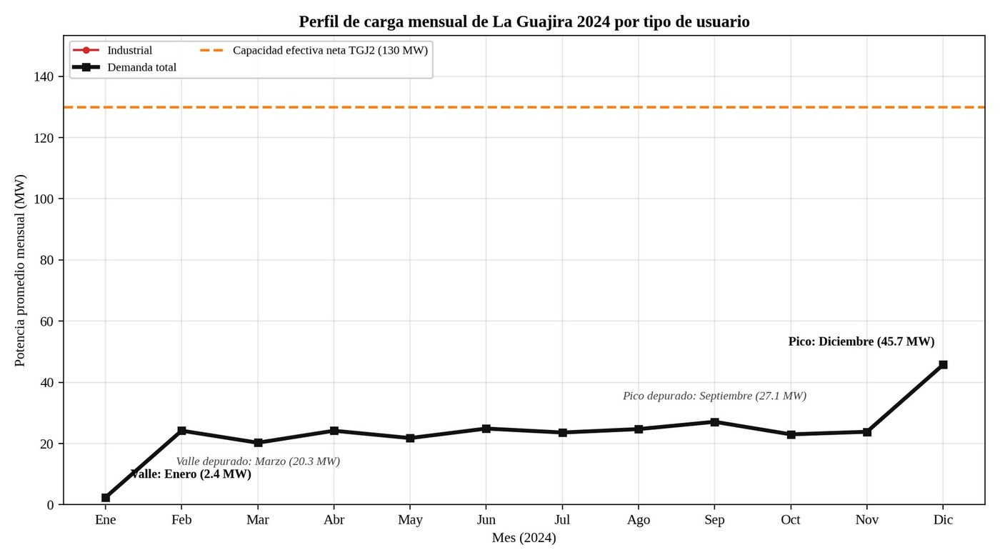
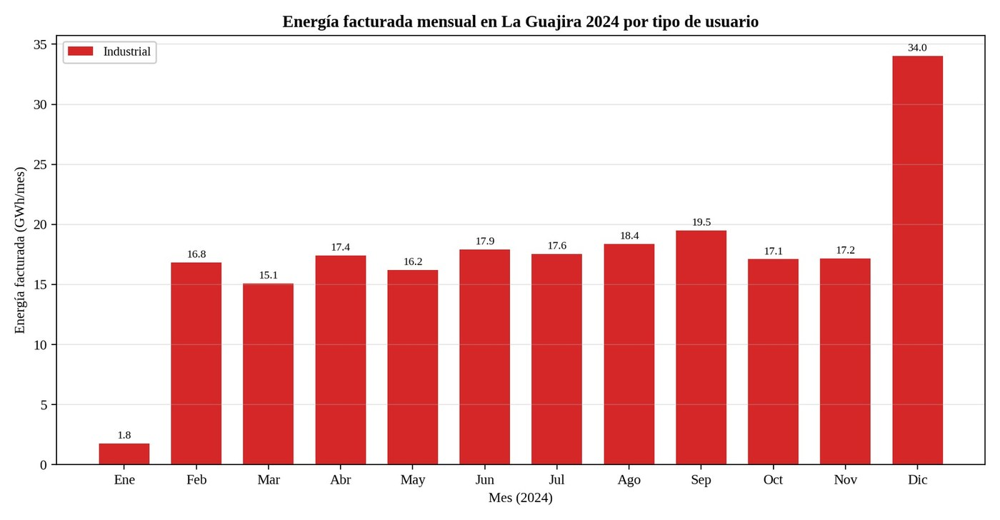

# Análisis de central térmica y perfil de demanda

**Sistemas Energéticos Integrados Multigeneración 2026-2 · EP1, proyecto de aula, primer corte**
Universidad ECCI, Bogotá D. C. · Docente: Juan Sebastián Solis Chávez · septiembre de 2026

Caracterización técnica de la central Termoguajira Unidad 2 (TGJ2) y perfil de demanda eléctrica del departamento de La Guajira (2024).

> Versión en Markdown del informe entregado. Trabajo en grupo de cuatro estudiantes; se retiraron los nombres y códigos de los integrantes. Las figuras 1, 2 y 3 del original eran capturas de plataformas de terceros (visor Paratec de XM, herramienta O3 del SUI y una fotografía de Google Maps) y no se incluyen aquí; los datos que mostraban están en las tablas 1 y 2. Las tablas y el texto se conservan como se entregaron.

---

## 1. Introducción y objetivos

### 1.1 Contexto

El departamento de La Guajira concentra una de las mayores paradojas del sistema energético colombiano. Su territorio alberga la mina de carbón a cielo abierto más grande de América Latina, yacimientos de gas natural que abastecieron al país durante décadas y el mejor recurso eólico y solar de Colombia; al mismo tiempo, registra algunos de los indicadores más bajos de cobertura, calidad y asequibilidad del servicio de energía eléctrica, con amplias zonas rurales y comunidades indígenas wayuu que dependen de soluciones aisladas o carecen de servicio. En ese contexto, la central Termoguajira, ubicada en el corregimiento de Mingueo (Dibulla), es la única central térmica de gran escala instalada en el departamento y constituye un caso de estudio pertinente para analizar la relación entre la infraestructura de generación existente, la demanda regional que la rodea y las alternativas de sustitución tecnológica que plantea la transición energética.

Este informe corresponde a la primera entrega del proyecto de aula del curso Sistemas Energéticos Integrados Multigeneración. Siguiendo la guía de la entrega, se caracteriza técnicamente la Unidad 2 de Termoguajira (código TGJ2 en el Sistema Interconectado Nacional, SIN) a partir del visor Paratec de XM, se delimita el área de influencia de la central y se dimensiona el perfil de demanda eléctrica mensual y anual del departamento de La Guajira, desagregado por tipo de usuario, con base en la información de facturación reportada por los comercializadores al Sistema Único de Información (SUI) de la Superintendencia de Servicios Públicos Domiciliarios (SSPD).

### 1.2 Objetivo general

Describir técnicamente la central termoeléctrica Termoguajira Unidad 2 y dimensionar el perfil de demanda eléctrica del departamento de La Guajira por tipo de usuario, con el fin de estimar el peso relativo de la central frente a la demanda regional y discutir su potencial de reemplazo por sistemas de multigeneración.

### 1.3 Objetivos específicos

1. Extraer del visor Paratec de XM y de fuentes oficiales complementarias los parámetros técnicos de la central: ubicación, propietario, capacidad efectiva neta, tecnología, combustible, fecha de entrada en operación y punto de conexión.
2. Identificar la subárea eléctrica del SIN a la que pertenece la central y justificar el uso del departamento de La Guajira como unidad geográfica de análisis de la demanda.
3. Construir la tabla maestra de energía facturada mensual (kWh) del año 2024 para los sectores residencial, comercial, industrial y oficial, y convertirla en un perfil de potencia promedio mensual (MW).
4. Identificar los meses de máxima y mínima demanda, calcular el factor de cobertura teórica de la central y evaluar si, por capacidad y tecnología, la unidad es candidata a ser reemplazada por un sistema de multigeneración.

### 1.4 Alcance y fuentes de información

El análisis se limita a la Unidad 2 de Termoguajira y al año calendario 2024, último año completo disponible en la herramienta de consulta de la SSPD al momento de la extracción. Las fuentes primarias son el visor Paratec y la API de datos abiertos de XM (parámetros técnicos de la central) y la herramienta O3 del SUI, vista Facturación de Energía (demanda por tipo de usuario). Se complementa con documentos oficiales del Ministerio de Minas y Energía, la UPME y Gecelca, y con prensa seria de circulación nacional. Todas las fechas de consulta se indican en la sección de referencias.

## 2. Ficha técnica de la central termoeléctrica (Fase 1)

La información de la Tabla 1 se extrajo del visor Paratec de XM (capa de generación térmica, ventana emergente del recurso GUAJIRA 2) y se verificó contra la API de datos abiertos de XM (métrica Capacidad Efectiva Neta por Recurso y listado de recursos con atributos), consultadas el 29 de agosto de 2026. La denominación comercial de la unidad es Termoguajira 2; en el sistema de XM figura como GUAJIRA 2 con el código de recurso TGJ2.

| Parámetro | Valor registrado |
|---|---|
| Nombre oficial de la central | Termoguajira Unidad 2 (en XM: GUAJIRA 2, código de recurso TGJ2). Hace parte de la Central Termoguajira, que integra las unidades 1 (TGJ1) y 2 (TGJ2). |
| Propietario / operador | Gecelca S.A. E.S.P., Generadora y Comercializadora de Energía del Caribe (código de agente en XM: GECG). Empresa de capital mayoritariamente público que opera y mantiene directamente la central. |
| Capacidad efectiva neta | 130 MW (Unidad 2). La Unidad 1 tiene 145 MW, para un total de 275 MW efectivos netos de la Central Termoguajira (290 MW instalados brutos según MinEnergía). |
| Tecnología primaria | Turbina de vapor (ciclo Rankine convencional con caldera de carbón pulverizado), de despacho central. Es decir, tecnología de vapor, no ciclo combinado ni turbogas. |
| Combustible principal | Carbón mineral (atributo de fuente energética en XM: CARBON). Paratec la registra como planta de mezcla de gas y carbón, pues utiliza gas natural como combustible secundario y de soporte para el arranque de las unidades. |
| Fecha de entrada en operación comercial | 23 de noviembre de 1987 (Unidad 2), fecha que coincide en la ventana de Paratec y en la API de XM. Para la Unidad 1, la API registra el 08/08/1983. |
| Subestación de conexión y nivel de tensión | Subestación Termoguajira (Guajira) a 220 kV, perteneciente al Sistema de Transmisión Nacional (STN), con circuitos a 220 kV hacia Santa Marta y hacia Cuestecitas (La Guajira). |
| Municipio y departamento | Corregimiento de Mingueo, municipio de Dibulla, departamento de La Guajira (sobre la Troncal del Caribe, entre Santa Marta y Riohacha). |
| Estado operativo | En operación, despacho centralizado por el CND (estado OPERACION en el listado de recursos de XM). |

*Tabla 1. Ficha técnica de Termoguajira Unidad 2 (TGJ2). Fuentes: XM Paratec y API XM; Gecelca; MinEnergía. Consulta: 29 de agosto de 2026.*

*Figura 1 (no incluida): ventana emergente del recurso GUAJIRA 2 en el visor Paratec de XM y fotografía de la caldera de la central (Google Maps). La ventana muestra tipo planta térmica, capacidad efectiva neta de 130 MW, fecha de puesta en operación 23/11/1987 y estado en operación.*

Termoguajira es una central de vapor a carbón diseñada originalmente para aprovechar el carbón del Cerrejón, con dos unidades gemelas que suman 275 MW de capacidad efectiva neta. Con casi cuatro décadas de operación, la Unidad 2 es una de las unidades térmicas más antiguas del SIN. La central cuenta con un sistema de control distribuido (DCS) para la operación de las unidades y, por su costo variable relativamente bajo frente a las térmicas a gas y a combustibles líquidos, ha sido históricamente una de las primeras térmicas en entrar en el despacho durante los periodos secos, cumpliendo un papel de respaldo para el Caribe colombiano.

En julio de 2023 el Ministerio de Minas y Energía anunció que Termoguajira sería la primera termoeléctrica del país en transitar hacia una generación 100 % descarbonizada, mediante un esquema de paneles solares, almacenamiento con baterías y condensadores síncronos que aprovecharía el punto de conexión existente. El Decreto 1276 de 2023, expedido en el marco de la emergencia económica, social y ecológica de La Guajira, previó recursos y garantía de la Nación para la transformación de las unidades Guajira 1 y Guajira 2. Este antecedente es relevante para la discusión de la sección 7, pues indica que la sustitución tecnológica de la unidad ya está contemplada en la política pública.

## 3. Definición del área de estudio (Fase 2)

### 3.1 Subárea eléctrica

En la división operativa del SIN que utiliza XM, la central Termoguajira pertenece al Área Caribe y, dentro de ella, a la subárea GCM (Guajira, Cesar y Magdalena). La subárea agrupa las subestaciones a 220 kV de Guajira (Termoguajira), Cuestecitas, Valledupar, Santa Marta, Fundación y Copey, y atiende la demanda de los tres departamentos a través de las redes de 110 kV de Air-e (La Guajira y Magdalena) y Afinia (Cesar). Desde octubre de 2025 la subárea cuenta además con la interconexión Cuestecitas, Copey y Fundación a 500/220 kV y la subestación Nueva Cuestecitas 500 kV, concebidas para evacuar la generación eólica y solar de La Guajira.

### 3.2 Área atendida: departamento de La Guajira

Una central térmica de despacho central no abastece a un municipio o a un departamento en particular: inyecta su energía al STN y el Centro Nacional de Despacho la asigna según el orden de mérito de costos y las restricciones eléctricas del sistema. Sin embargo, siguiendo la regla definida en la guía del proyecto, se adopta el departamento donde está instalada la central, La Guajira, como unidad geográfica de análisis de la demanda. Esta elección se justifica por tres razones:

1. **Influencia directa en el despacho local.** Por su ubicación en el extremo nororiental del STN, en un área históricamente radial y con limitaciones de transferencia, Termoguajira es generación de seguridad para la subárea GCM: cuando se presentan contingencias en los circuitos a 220 kV entre Guajira y Santa Marta o entre Cuestecitas y Valledupar, la unidad puede quedar atendiendo de forma aislada las cargas de las subestaciones Guajira y Cuestecitas, es decir, la demanda de La Guajira. La evidencia empírica lo confirma: el 1.º de abril de 2019, tras un evento técnico de generación en Termoguajira, el Centro Nacional de Despacho ordenó racionamientos que afectaron, entre otros, los circuitos de las subestaciones Fonseca y Cuestecitas en La Guajira (El Heraldo, 2019). Por esta condición radial, la planeación ha definido refuerzos para la subárea, como la interconexión Cuestecitas, Copey y Fundación a 500/220 kV en servicio desde 2025.
2. **Coherencia con la herramienta de demanda.** El SUI de la SSPD organiza la facturación de energía por departamento y municipio, de modo que el departamento es la unidad más práctica y verificable para construir el perfil por tipo de usuario.
3. **Pertinencia territorial.** La Guajira es un departamento con déficit estructural de cobertura y calidad del servicio; comparar la capacidad de la única central de gran escala instalada en su territorio con la demanda que efectivamente factura el departamento permite dimensionar el contraste entre el recurso energético que exporta y el servicio que recibe.

**Alcance y exclusiones.** La demanda facturada que reporta el SUI corresponde a los usuarios regulados y no regulados atendidos por todos los comercializadores con presencia en el departamento (no solo el operador de red Air-e, cuya red de distribución atiende el mercado regulado guajiro). Quedan por fuera, en particular, la autogeneración de la mina del Cerrejón, que no pasa por la facturación de los comercializadores, y las localidades de la Alta Guajira pertenecientes a las Zonas No Interconectadas (ZNI), que no hacen parte del SIN. Por ello, el perfil que se construye en las secciones siguientes representa la demanda comercial del departamento dentro del SIN y no necesariamente toda la energía consumida en su territorio.

### 3.3 Mapa de localización

*Figura 2 (no incluida): localización de la central Termoguajira en el visor Paratec de XM: contorno del departamento de La Guajira, marcador de las unidades en Dibulla, ventana con los datos de Guajira 1 (145 MW) y Guajira 2 (130 MW) y encabezado de la subárea Guajira, Cesar y Magdalena (2 plantas térmicas, 275 MW). El mapa propio del segundo corte está en [`graficas/Info1_Mapa_Colombia.png`](../graficas/Info1_Mapa_Colombia.png).*

La captura del visor sintetiza los tres elementos que pide la guía: la ubicación física de la central en Dibulla, sobre la franja costera occidental del departamento; la pertenencia de las dos unidades a la subárea Guajira, Cesar y Magdalena, cuyo encabezado registra 275 MW térmicos instalados que corresponden exactamente a la suma de Guajira 1 y Guajira 2; y la delimitación del departamento de La Guajira que se adopta como área de demanda. Obsérvese que la ventana emergente de Paratec muestra el 23/11/1987 como fecha de puesta en operación de ambas unidades, mientras que el listado de recursos de la API de XM registra el 08/08/1983 para la Unidad 1; para la Unidad 2, objeto de este informe, ambas fuentes coinciden.

## 4. Metodología de extracción y procesamiento (Fases 3 y 4)

### 4.1 Extracción del perfil de demanda en la herramienta O3 del SUI

La demanda por tipo de usuario se obtuvo de la herramienta O3 de la SSPD (SUI Comercial Energía, vista Facturación de Energía), que consolida los formatos de facturación que los comercializadores reportan mensualmente al SUI. La consulta se orientó con los siguientes criterios:

- **Dimensión Departamento:** La Guajira (código DANE 44), incluyendo todos sus municipios para obtener el total departamental.
- **Dimensión Año:** 2024; dimensión Mes: enero a diciembre.
- **Dimensiones de clasificación:** la vista organiza la información por empresa, por tipo de usuario y por estrato / sector de consumo. El desglose que pide la guía (residencial como agregación de los estratos 1 a 6, comercial, industrial y oficial) corresponde a la dimensión de estrato o sector.
- **Hechos:** energía facturada (kWh) y número de suscriptores.

Los resultados se transcribieron y organizaron en una matriz de 4 tipos de usuario por 12 meses, con la energía facturada en kWh en cada celda (archivo de trabajo del grupo, no incluido en este repositorio; los valores están en la Tabla 2). La información que la vista puso a disposición en la consulta correspondió al sector industrial, como se detalla en el numeral 4.3.

### 4.2 Procesamiento y dimensionamiento

A partir de la matriz de energía se calcularon, para cada mes *m*:

- **Energía total del mes:** Em = suma de la energía facturada de los cuatro tipos de usuario (kWh).
- **Energía anual:** Eaño = Σ Em (kWh), convertida a GWh/año dividiendo entre 1 000 000.
- **Potencia promedio mensual:** Pm (MW) = Em (kWh) / [hm × 1 000], donde hm son las horas del mes (días × 24; 2024 es bisiesto, por lo que febrero tiene 696 horas). Se divide entre 1 000 para pasar de kW a MW; este es el ajuste de unidades al que se refiere la guía en el paso 4.3.
- **Mes pico y mes valle:** máximo y mínimo de la potencia promedio mensual.
- **Factor de cobertura teórica (%):** FC = (Capacidad efectiva neta de la central / Ppico) × 100. Se utiliza la capacidad efectiva neta reportada por XM (130 MW) porque es la potencia que la unidad puede entregar de forma sostenida al sistema, descontados sus consumos auxiliares.

Debe tenerse presente que la potencia promedio mensual es una potencia media (energía del mes repartida uniformemente en sus horas) y no la demanda máxima instantánea del departamento; la demanda pico horaria real es mayor, típicamente entre 1,3 y 1,6 veces la potencia media en sistemas con fuerte componente residencial y de refrigeración. El factor de cobertura calculado con la potencia media es, por tanto, una cota superior.

### 4.3 Alcance de los datos utilizados

La información disponible en la vista Facturación de Energía al momento de la consulta correspondió al sector industrial del departamento: la serie de energía facturada y de número de suscriptores que mostraba la Figura 3, reportada por la comercializadora Gecelca S.A. E.S.P. (código SUI 21600). Siguiendo la recomendación de la propia guía para los casos de fallas de la plataforma, el grupo decidió desarrollar el análisis con la información que la herramienta puso a disposición, dejando en cero las filas residencial, comercial y oficial de la matriz; durante la elaboración del informe la plataforma presentó además interrupciones prolongadas de servicio (error 503 del servidor bi.superservicios.gov.co, verificado el 29, el 30 y el 31 de agosto de 2026) que impidieron ampliar la consulta. En consecuencia, las cifras de demanda total, mes pico, mes valle y factor de cobertura de las secciones 5 a 7 describen el segmento industrial disponible y no la demanda departamental completa, salvedad que se incorpora explícitamente en el análisis.

**Lectura de la serie disponible.** Se trata de un segmento con muy pocos usuarios de gran tamaño (entre 2 y 4 suscriptores según el mes), de modo que cualquier novedad contractual o de facturación de un solo cliente mueve toda la serie. En enero se facturaron 1,8 GWh frente a 16,8 GWh en febrero con el mismo número de suscriptores: falta el equivalente a un mes completo de uno de los grandes usuarios (unos 15 GWh). En diciembre se facturaron 34,0 GWh, unos 17 GWh por encima de un mes típico, y la suma de enero y diciembre equivale casi exactamente a dos meses promedio. El patrón es consistente con un desplazamiento de facturación, es decir, consumo de enero facturado o ajustado al cierre del año, y no con un comportamiento real de la demanda; la sección 7 maneja este ajuste en el análisis sin alterar los valores oficialmente reportados al SUI.

*Figura 3 (no incluida): consulta del grupo en la herramienta O3 del SUI (vista Facturación de Energía): número de suscriptores y energía facturada mensual del sector industrial de La Guajira, 2024. Los valores de energía están en la Tabla 2.*

> Nota de esta versión: en el segundo corte el grupo obtuvo la demanda completa del departamento (todas las empresas y sectores, 1.028,5 GWh facturados en 2024) desde otro reporte público del SUI; ver [`informe-corte-2.md`](informe-corte-2.md) y la carpeta [`demanda/`](../demanda/).

## 5. Tabla maestra de demanda

La Tabla 2 presenta la energía facturada mensual en La Guajira durante 2024, desagregada por tipo de usuario, en kWh, junto con el total mensual en kWh y GWh. Conforme al alcance descrito en el numeral 4.3, la serie diligenciada es la del sector industrial; las filas residencial, comercial y oficial se presentan en cero.

| Mes | Residencial (kWh) | Comercial (kWh) | Industrial (kWh) | Oficial (kWh) | Total (kWh) | Total (GWh) |
|---|---:|---:|---:|---:|---:|---:|
| Enero | 0 | 0 | 1.776.355 | 0 | 1.776.355 | 1,78 |
| Febrero | 0 | 0 | 16.837.710 | 0 | 16.837.710 | 16,84 |
| Marzo | 0 | 0 | 15.073.660 | 0 | 15.073.660 | 15,07 |
| Abril | 0 | 0 | 17.410.214 | 0 | 17.410.214 | 17,41 |
| Mayo | 0 | 0 | 16.204.704 | 0 | 16.204.704 | 16,20 |
| Junio | 0 | 0 | 17.920.050 | 0 | 17.920.050 | 17,92 |
| Julio | 0 | 0 | 17.558.619 | 0 | 17.558.619 | 17,56 |
| Agosto | 0 | 0 | 18.389.198 | 0 | 18.389.198 | 18,39 |
| Septiembre | 0 | 0 | 19.507.548 | 0 | 19.507.548 | 19,51 |
| Octubre | 0 | 0 | 17.106.035 | 0 | 17.106.035 | 17,11 |
| Noviembre | 0 | 0 | 17.165.932 | 0 | 17.165.932 | 17,17 |
| Diciembre | 0 | 0 | 34.036.631 | 0 | 34.036.631 | 34,04 |
| **Total anual** | 0 | 0 | 208.986.656 | 0 | 208.986.656 | 208,99 |

*Tabla 2. Energía facturada mensual en La Guajira 2024 por tipo de usuario. Fuente: SSPD, herramienta O3 del SUI, vista Facturación de Energía (consulta del grupo, agosto de 2026). Elaboración propia.*

La Tabla 3 resume la energía anual y la participación de cada sector, así como la potencia media anual equivalente (energía anual dividida entre las 8.784 horas del año).

| Tipo de usuario | Energía anual (GWh) | Participación (%) | Potencia media (MW) |
|---|---:|---:|---:|
| Residencial | 0,00 | 0,0 | 0,00 |
| Comercial | 0,00 | 0,0 | 0,00 |
| Industrial | 208,99 | 100,0 | 23,79 |
| Oficial | 0,00 | 0,0 | 0,00 |
| **Total departamento** | 208,99 | 100,0 | 23,81 |

*Tabla 3. Resumen anual de la demanda facturada de La Guajira 2024 por tipo de usuario. Elaboración propia a partir de la Tabla 2.*

La Tabla 4 convierte la energía mensual en potencia promedio mensual, aplicando la expresión del numeral 4.2, e identifica el mes pico y el mes valle. La última columna expresa cada mes como fracción de la potencia media anual.

| Mes | Días | Horas | Energía total (kWh) | Potencia promedio (MW) | Índice vs. promedio |
|---|---:|---:|---:|---:|---:|
| Enero (valle) | 31 | 744 | 1.776.355 | 2,39 | 0,10 |
| Febrero | 29 | 696 | 16.837.710 | 24,19 | 1,02 |
| Marzo | 31 | 744 | 15.073.660 | 20,26 | 0,85 |
| Abril | 30 | 720 | 17.410.214 | 24,18 | 1,02 |
| Mayo | 31 | 744 | 16.204.704 | 21,78 | 0,91 |
| Junio | 30 | 720 | 17.920.050 | 24,89 | 1,05 |
| Julio | 31 | 744 | 17.558.619 | 23,60 | 0,99 |
| Agosto | 31 | 744 | 18.389.198 | 24,72 | 1,04 |
| Septiembre | 30 | 720 | 19.507.548 | 27,09 | 1,14 |
| Octubre | 31 | 744 | 17.106.035 | 22,99 | 0,97 |
| Noviembre | 30 | 720 | 17.165.932 | 23,84 | 1,00 |
| Diciembre (pico) | 31 | 744 | 34.036.631 | 45,75 | 1,92 |
| **Promedio / total** | 366 | 8784 | 208.986.656 | 23,81 | 1,00 |

*Tabla 4. Potencia promedio mensual de la demanda facturada de La Guajira 2024. Elaboración propia.*

## 6. Gráfica de perfil de carga

La Figura 4 muestra la curva de demanda total del departamento expresada en potencia promedio mensual (MW), con líneas diferenciadas para cada tipo de usuario, y la compara con la capacidad efectiva neta de Termoguajira 2 (130 MW, línea punteada). La Figura 5 presenta la energía facturada mensual apilada por sector, en GWh, que permite apreciar la incidencia de cada tipo de usuario en el total. Ambas gráficas se construyen sobre la matriz descrita en el numeral 4.3: la línea industrial coincide con la demanda total porque es la única serie diligenciada.

*Figura 4. Perfil de carga mensual de La Guajira 2024 por tipo de usuario (potencia promedio mensual, MW) frente a la capacidad efectiva neta de TGJ2. Elaboración propia.*

*Figura 5. Energía facturada mensual en La Guajira 2024 por tipo de usuario (GWh). Elaboración propia.*

## 7. Análisis de resultados

### 7.1 Mes de máxima y mínima demanda

Con la matriz de demanda construida en la sección 5, la potencia promedio mensual de La Guajira alcanza su máximo en diciembre (45,7 MW) y su mínimo en enero (2,4 MW), con una potencia media anual de 23,8 MW y una energía anual facturada de 209,0 GWh. El pico supera al valle en 1.816 %. Como se explicó en el numeral 4.3, estos valores corresponden al segmento industrial disponible en la herramienta, facturado por Gecelca a un número reducido de grandes usuarios, y el valle de enero y el pico de diciembre son las dos caras de un mismo artefacto de facturación: a uno de los dos grandes usuarios del portafolio no se le facturó el consumo de enero, que aparece acumulado en el ajuste de diciembre, como lo evidencia que la suma de ambos meses equivalga a dos meses típicos de la serie. El mes pico y el mes valle identificados no describen, por tanto, el comportamiento real de la demanda departamental y deben recalcularse con la matriz completa. Depurada de esos dos efectos, es decir, analizando la ventana de febrero a noviembre, el mes de mayor consumo real de la serie disponible es septiembre (19,51 GWh; 27,1 MW promedio) y el de menor es marzo (15,07 GWh; 20,3 MW). La serie depurada es notablemente plana, con una banda de 20 a 27 MW, lo que es consistente con un puñado de cargas industriales de operación continua cuya variación mensual responde a calendarios de producción y mantenimiento más que al clima. Obsérvese, de paso, que febrero factura menos energía que la mayoría de los meses simplemente por tener menos días, pero en potencia promedio no es el valle: esa es la razón por la que la guía exige comparar los meses en MW promedio y no en kWh. En la Tabla 2 se conservan los valores oficialmente reportados al SUI, sin redistribuir enero ni diciembre; el ajuste se maneja en el análisis para no alterar la fuente.

Desde el punto de vista de los determinantes de la demanda, en La Guajira cabe esperar un perfil relativamente plano, con estacionalidad moderada, por las siguientes razones. En primer lugar, el clima cálido y seco es constante a lo largo del año: las temperaturas medias superan los 27 °C en todos los meses y los máximos térmicos se presentan en el periodo seco de junio a agosto (veranillo) y en marzo y abril, lo que sostiene una carga de refrigeración, ventilación y aire acondicionado en los sectores residencial y comercial que no desaparece en ningún mes. En segundo lugar, la carga industrial está dominada por operaciones mineras y portuarias que funcionan de manera continua y actúan como carga base, de modo que las variaciones mensuales del sector industrial reflejan más los calendarios de producción y mantenimiento que el clima. En tercer lugar, la temporada de fin de año (diciembre) y las vacaciones de mitad de año (junio y julio) elevan la demanda residencial y comercial por el turismo en Riohacha, Palomino, Cabo de la Vela y el corredor de Dibulla, y por la mayor permanencia de las familias en sus viviendas; el segundo semestre coincide además con la temporada de lluvias (septiembre a noviembre), que en la costa Caribe suele venir acompañada de mayor humedad y demanda de climatización.

**¿Por qué el pico real cae en septiembre?** El máximo depurado supera en un 14 % el promedio de la ventana de febrero a noviembre (23,8 MW) y el valle de marzo queda un 15 % por debajo: una amplitud moderada que apunta al régimen operativo de las pocas plantas del segmento y no al clima. En cargas industriales de esta escala el calendario típico concentra los mantenimientos mayores y las paradas programadas en el primer semestre y eleva la producción en el segundo, de cara a los compromisos de entrega y al cierre del año; bajo esa lógica, el mínimo de marzo es consistente con la parada de alguno de los usuarios y el máximo de septiembre con la plena operación simultánea de todos, en un mes en el que, además, el calor y la alta humedad del litoral Caribe mantienen exigidos los sistemas de refrigeración y climatización industrial. El clima actúa, en todo caso, como carga de fondo y no como causa principal: sostiene la refrigeración durante los doce meses, pero no tiene la magnitud para producir por sí solo la amplitud observada. La mejor prueba de que este segmento responde a lógicas de producción y no de confort térmico está en el contraste con lo que se esperaría de las series ausentes: con datos residenciales y comerciales, el pico probable se ubicaría en diciembre, por el turismo y las festividades, o entre junio y agosto, por el estrés térmico del veranillo sobre la climatización.

### 7.2 Cobertura de la central frente a la demanda regional

La capacidad efectiva neta de Termoguajira 2 es de 130 MW. Frente a la demanda pico mensual del departamento (45,7 MW en diciembre), el factor de cobertura teórica es FC = (130 / 45,7) × 100 = 284,2 %. Frente a la potencia media anual (23,8 MW) la relación es de 546 %. Dicho de otra forma, la energía que la unidad produciría operando a plena carga durante todo el año (1.142 GWh) equivale a 5,5 veces la energía facturada en el departamento.

Este valor debe leerse con la salvedad del numeral 4.3: la matriz cubre el segmento industrial disponible y no incluye las series residencial, comercial y oficial del departamento, de modo que la demanda departamental real es mayor y el factor de cobertura efectivo, menor. Aun así, el orden de magnitud es informativo: La Guajira es un mercado pequeño dentro del SIN, de modo que una sola unidad de 130 MW representa una fracción muy alta de su demanda media, mientras que en departamentos como Atlántico o Cundinamarca la misma unidad cubriría una fracción marginal. Lo anterior no significa que Termoguajira abastezca a La Guajira: la unidad inyecta al STN y el departamento se alimenta del sistema a través de las subestaciones Cuestecitas y Guajira, con la energía que el despacho económico asigne en cada hora. Lo que el factor de cobertura muestra es la desproporción entre la capacidad de generación instalada en el territorio (a la que se suman las plantas eólicas y solares en construcción) y el consumo que el departamento factura, que es la base cuantitativa de la llamada paradoja energética guajira.

### 7.3 ¿Es candidata a ser reemplazada por un sistema de multigeneración?

Por capacidad, Termoguajira 2 sí es candidata a sustitución: 130 MW es una escala relevante para la subárea GCM y la unidad tiene 39 años de operación, edad en la que las centrales de vapor a carbón alcanzan el final de su vida útil de diseño, presentan eficiencias netas bajas (del orden de 30 a 33 %) y costos crecientes de mantenimiento, como lo evidencian las salidas forzadas registradas en años secos. Por tecnología, se trata de un ciclo de vapor a carbón que rechaza al ambiente cerca de dos tercios de la energía del combustible en forma de calor de baja temperatura, sin ningún aprovechamiento útil, y que es la fuente puntual de emisiones de CO2, SO2, NOx y material particulado más importante del departamento; su transformación ya fue anunciada por el Gobierno Nacional y financiada mediante el Decreto 1276 de 2023.

La pregunta relevante para el curso es qué configuración de multigeneración tendría sentido en Mingueo. Un sistema de trigeneración clásico (calor + electricidad + frío) requiere demandas térmicas simultáneas cercanas a la planta; en la zona no existe demanda industrial de calor de proceso significativa, pero sí existen dos demandas que un sistema integrado podría atender con el calor residual de un ciclo motor: la producción de agua desalinizada, dado que la escasez de agua potable es el principal problema de acceso a servicios en La Guajira y el calor de baja temperatura puede alimentar procesos de destilación multiefecto o precalentar ósmosis inversa; y la producción de frío para la cadena de refrigeración agroindustrial y pesquera, la conservación de alimentos y la climatización de equipamientos públicos, mediante enfriadores de absorción. Una configuración plausible es un ciclo combinado o motores a gas de menor tamaño (del orden de 50 a 80 MW) operando en cogeneración con desalinización y frío por absorción, complementados por generación solar fotovoltaica, eólica y almacenamiento en baterías, que aprovechen el punto de conexión a 220 kV existente. Esta alternativa reduciría el consumo de combustible por unidad de servicio energético, ofrecería respaldo firme para la subárea GCM y convertiría a la central en un activo del nexo agua, energía y alimentos del departamento, en lugar de un simple exportador de electricidad.

En síntesis, la unidad no es demasiado pequeña para justificar la multigeneración; por el contrario, su tamaño, su antigüedad, su tecnología y el mandato de política pública la convierten en un caso prioritario. La restricción no es de escala sino de diseño: el sistema de reemplazo debe dimensionarse a partir de las demandas locales de agua, frío y electricidad, y no únicamente a partir de la capacidad eléctrica instalada hoy.

## 8. Conclusiones

1. **Termoguajira 2 vale hoy para el sistema más por su respaldo que por su energía.** La unidad tiene 39 años, opera con vapor a carbón de baja eficiencia y contamina más que las alternativas modernas. Aun así, sigue siendo necesaria, porque es la generación de seguridad de una subárea radial: cuando la central falla, La Guajira lo siente en cuestión de horas, como ocurrió con el racionamiento de abril de 2019. Por eso, cualquier proyecto que busque reemplazarla debe garantizar ese mismo respaldo y soporte de red en el nodo de 220 kV. No basta con producir la misma cantidad de energía.
2. **Analizar la demanda del departamento de La Guajira no fue solo una regla de la guía: es la elección correcta, y la evidencia operativa lo confirma.** La unidad ha llegado a operar aislada alimentando las cargas de Guajira y Cuestecitas, y sus fallas han provocado racionamientos dentro del propio departamento. Existe, entonces, un vínculo físico real entre la central y la continuidad del servicio guajiro. Por eso el perfil de demanda departamental es la referencia correcta para dimensionar a su reemplazo.
3. **La carga industrial medida resultó ser concentrada, plana y previsible.** Sin los dos meses afectados por el artefacto de facturación, la serie se mueve entre 20,3 y 27,1 MW, con una relación entre valle y pico de 0,75. Ese comportamiento es típico de una carga base: lo gobiernan los calendarios de producción, con los mantenimientos en el primer semestre y la máxima operación hacia septiembre, y no el clima. Una demanda así es ideal para un esquema de suministro dedicado, porque mantiene alto el factor de utilización. Esto refuerza la viabilidad técnica de un reemplazo con multigeneración.
4. **El ejercicio también deja una lección de método: los datos de facturación del SUI no se pueden leer de forma literal.** Una lectura ingenua habría ubicado el pico en diciembre y el valle en enero. La aritmética demuestra otra cosa: enero y diciembre suman el equivalente a dos meses típicos, en un segmento de apenas 2 a 4 suscriptores, así que se trata de un desplazamiento contable y el máximo real es septiembre. Convertir a MW promedio y depurar estos artefactos no es un refinamiento opcional: es lo que hace válido el análisis. La energía anual, en cambio, sí es un dato robusto (209,0 GWh), porque los desplazamientos entre meses no alteran el total del año.
5. **Los números cuantifican la paradoja energética guajira.** Los 130 MW de la unidad equivalen a 5,5 veces la potencia media del segmento medido (23,8 MW), y el factor de cobertura formal llega a 284 %. La demanda completa del departamento es mayor, pero la relación seguiría siendo holgada si se suman los 275 MW de la central y la nueva generación renovable del territorio. La conclusión es clara: a La Guajira no le falta capacidad de generación; le faltan acceso, redes y tarifas asequibles. Reemplazar la central por más megavatios no resuelve ese problema. La sustitución debe traer servicios para el territorio.
6. **Por todo lo anterior, la unidad no solo es candidata a la sustitución por multigeneración: es un caso prioritario en el país,** por su escala, su edad, su tecnología y el mandato del Decreto 1276 de 2023. Como en Mingueo no hay demanda de calor de proceso, la configuración adecuada no es la trigeneración industrial clásica. Lo pertinente es un sistema que entregue electricidad, agua desalinizada y frío por absorción, apoyado en generación solar, eólica y almacenamiento sobre el punto de conexión existente. Y la clave de diseño es esta: el nuevo sistema debe dimensionarse desde las demandas locales de agua, frío y electricidad, no desde los 130 MW instalados hoy.

## 9. Referencias

Todas las páginas fueron consultadas en las fechas indicadas entre paréntesis.

- XM S.A. E.S.P. Paratec, parámetros técnicos del SIN, mapa interactivo. https://paratec.xm.com.co/mapa (consultado en agosto de 2026; capturas del grupo).
- XM S.A. E.S.P. API de datos abiertos del SIN (servapibi.xm.com.co): métricas Capacidad Efectiva Neta por Recurso (CapEfecNeta) y Listado de Recursos con atributos (ListadoRecursos). https://servapibi.xm.com.co (consultado el 29 de agosto de 2026).
- XM S.A. E.S.P. Informe anual: Evolución del Sistema Interconectado Nacional. https://informeanual.xm.com.co/informe/pages/xm/25-evolucion-del-sistema-interconectado-nacional.html (consultado el 29 de agosto de 2026).
- Superintendencia de Servicios Públicos Domiciliarios. Sistema Único de Información (SUI): herramienta O3, SUI Comercial Energía, vista Facturación de Energía. http://bi.superservicios.gov.co/o3web/browser/showView.jsp?viewDesktop=true&source=SUI_COMERCIAL_ENERGIA/VISTA_FACTURACION_ENERGIA%23_public (consultado en agosto de 2026, capturas del grupo; fuera de servicio con error 503 entre el 29 y el 31 de agosto de 2026).
- Superintendencia de Servicios Públicos Domiciliarios. Portal SUI, reportes comerciales de energía: Consolidado energía por empresa, departamento y municipio. http://sui.superservicios.gov.co/Reportes-del-sector/Energia/Reportes-comerciales (consultado el 29 de agosto de 2026).
- Gecelca S.A. E.S.P. Unidades de negocio, Generación: Central Termoguajira. https://www.gecelca.com.co/es/unidades-de-negocio/generacion-2/ (consultado el 29 de agosto de 2026).
- Ministerio de Minas y Energía (1 de julio de 2023). Central Termoguajira será la primera en transitar hacia generación eléctrica 100 % descarbonizada. https://www.minenergia.gov.co/es/sala-de-prensa/noticias-index/central-termoguajira-ser%C3%A1-la-primera-en-transitar-hacia-generaci%C3%B3n-el%C3%A9ctrica-100-descarbonizada/ (consultado el 29 de agosto de 2026).
- Ministerio de Minas y Energía (1 de agosto de 2023). Gobierno Nacional expide Decreto para ampliar la cobertura y el acceso al servicio público de energía eléctrica en La Guajira (Decreto 1276 de 2023). https://www.minenergia.gov.co/es/sala-de-prensa/noticias-index/gobierno-nacional-expide-decreto-para-ampliar-la-cobertura-y-el-acceso-al-servicio-p%C3%BAblico-de-energ%C3%ADa-el%C3%A9ctrica-en-la-guajira/ (consultado el 29 de agosto de 2026).
- Ministerio de Minas y Energía (17 de octubre de 2025). Por primera vez, La Guajira se conecta al sistema eléctrico nacional con una subestación de 500 kilovoltios. https://www.minenergia.gov.co/es/sala-de-prensa/noticias-index/por-primera-vez-la-guajira-se-conecta-al-sistema-electrico-nacional-con-subestacion-500-kilovoltios/ (consultado el 29 de agosto de 2026).
- ISA Intercolombia. Proyecto de Interconexión Cuestecitas, Copey y Fundación a 500/220 kV. https://www.isaintercolombia.com/proyecto-de-interconexion-cuestecitas-copey-fundacion-a-500-220-mil-voltios-2/ (consultado el 29 de agosto de 2026).
- Asociación Nacional de Empresas Generadoras, ANDEG. Empresa asociada: Gecelca. https://andeg.org/empresa-asociada/gecelca/ (consultado el 29 de agosto de 2026).
- Global Energy Monitor. Termoguajira power station. https://www.gem.wiki/Termoguajira_power_station (consultado el 29 de agosto de 2026).
- UPME (diciembre de 2024). Proyección de la demanda de energía eléctrica y potencia máxima. https://www1.upme.gov.co/DemandayEficiencia/Documents/Informe_de_proyeccion_de_demanda_de_energia_electrica_y_potencia_maxima_Rev_dic2024.pdf (consultado el 29 de agosto de 2026).
- El Colombiano (5 de julio de 2023). Nación se alista para la primera planta termoeléctrica que operará con energía solar. https://www.elcolombiano.com/negocios/termoguajira-la-pirmera-termoelectrica-que-funcionara-con-energia-solar-ND21887569 (consultado el 29 de agosto de 2026).
- El Tiempo (18 de marzo de 2016). Termoguajira, sin operar por postergar su mantenimiento. https://www.eltiempo.com/archivo/documento/CMS-16540060 (consultado el 29 de agosto de 2026).
- El Heraldo (2 de abril de 2019). Por problemas de generación de energía en Termoguajira, realizan racionamientos. https://www.elheraldo.co/barranquilla/2019/04/02/por-problemas-de-generacion-de-energia-en-termoguajira-realizan-racionamientos-614938/ (consultado el 31 de agosto de 2026).
