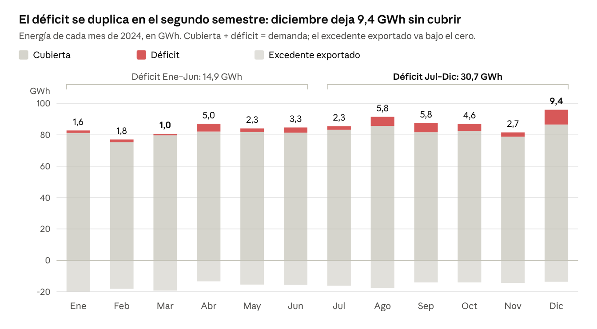

# SEI Termoguajira 2: informe del segundo corte

**Sistemas Energéticos Integrados Multigeneración 2026-2 · EP1, proyecto de aula, segundo corte**
Universidad ECCI, Bogotá D. C. · octubre de 2026

Sistema energético integrado (SEI) de celda de combustible de óxido sólido (SOFC) con hidrógeno, solar fotovoltaica (FV) y batería, simulado en System Advisor Model (SAM) 2026.7.3 de NREL, como reemplazo de la unidad Termoguajira 2.

> Versión en Markdown del informe de avance del segundo corte. Trabajo en grupo de cuatro estudiantes; se retiraron los nombres y códigos de los integrantes. Cambios frente al original: (1) la sección «Análisis y conclusiones», que en el informe de avance solo tenía preguntas guía, se reemplazó por el texto del Anexo 4 que el grupo entregó; (2) se omitió la tabla de estado de los entregables, que era de gestión interna; (3) las rutas de archivos se actualizaron a la estructura de este repositorio. Las cifras se conservan como se entregaron. La revisión posterior con el barrido de 2.271 casos está en el [README](../README.md#results-and-measurements).

---

## Resumen

Un SEI de 130 MW firmes cubre el 95,6 % de la demanda horaria de La Guajira de 2024, según la simulación del grupo en SAM 2026.7.3.

Combina una SOFC de 110 MW con hidrógeno, una batería de 20 MW / 160 MWh y un parque FV de 300 MWdc. Reemplaza los 130 MW de Termoguajira 2 y se probó contra la demanda de todo el departamento: 1.025,6 GWh, media 117 MW y pico 152 MW.

Faltan 45,6 GWh en 3.225 horas, el 81 % de noche. Sobran 191,9 GWh, todos entre las 6 y las 16 h, que se exportan a la red.

## Contexto: Termoguajira y la red

Termoguajira 2 (TGJ2, Gecelca, carbón, Dibulla) generó 741 GWh en 2024: el 65 % de lo que daría a plena carga. Estuvo 1.696 horas en cero y en septiembre solo generó 10,7 GWh.

Como referencia, el SEI simulado cubre el 95,6 % y una TGJ2 ideal, a 130 MW las 8.784 h del año, cubriría el 99,2 %. Ninguna opción de 130 MW llega al 100 % porque La Guajira pide hasta 152 MW.

Ninguna central genera para «su» región. Termoguajira entrega a la red nacional (SIN) por la subestación Termoguajira 220 kV, XM la despacha para todo el país y la corriente se consume primero cerca, en la Costa Caribe. El 62 % de lo generado en 2024 fue generación de seguridad: XM mantuvo las unidades encendidas porque la red del Caribe las necesitaba.

| Unidad | Capacidad (MW) | Generación 2024 (GWh) | Factor de planta | Generación de seguridad (GWh) | Cubriría de La Guajira, hora a hora |
|---|---:|---:|---:|---:|---:|
| Termoguajira 1 (TGJ1) | 145 | 912 | 72 % | 551 | 76,8 % |
| Termoguajira 2 (TGJ2) | 130 | 741 | 65 % | 478 | 68,0 % |
| TGJ1 + TGJ2 | 275 | 1.653 | 68 % | 1.029 | 94,3 % |

Datos: [`demanda/xm_generacion_termoguajira_2024_horario_kWh.csv`](../demanda/xm_generacion_termoguajira_2024_horario_kWh.csv) y [`demanda/xm_generacion_seguridad_termoguajira_2024.json`](../demanda/xm_generacion_seguridad_termoguajira_2024.json) (API de datos abiertos de XM).

Por eso la prueba de la guía es un experimento: cuánto de La Guajira cubriría, por sí solo, el reemplazo de TGJ2. El déficit lo cubriría el resto del SIN y el excedente saldría a la red.

## Demanda de La Guajira 2024

La Guajira consumió 1.028,5 GWh facturados en 2024; en SAM son 1.025,6 GWh porque el año simulado tiene 8.760 h. La media es 117 MW, el pico 152 MW (16-sep, 14:00) y el mínimo 77 MW.

- **Energía mensual por empresa y sector:** reporte público de Power BI del SUI «Consolidado de energía por empresa y departamento», 14 comercializadores con ventas. Air-e, el operador regulado, vende el 78 %. El primer corte solo tenía el segmento industrial (209 GWh).
- **Forma horaria:** demanda comercial horaria de XM del mercado CARIBE SOL, separada en regulada y no regulada.

De los 892,2 GWh reportados se llega a los 1.025,6 GWh simulados con tres ajustes:

1. Air-e no reportó septiembre ni octubre. Se estimaron como el 9,1 % de la demanda regulada de XM, su relación promedio en los meses normales (+136,3 GWh).
2. Gecelca facturó en diciembre el consumo de enero. Se repartió por partes iguales entre ambos meses (16,1 GWh pasan de diciembre a enero).
3. SAM usa años de 8.760 h, así que se quitó el 29 de febrero (−2,9 GWh).

El perfil de 8.760 h reparte cada mes la energía de Air-e con la forma horaria regulada de XM, y la del resto con la no regulada. La demanda supera 130 MW en 1.287 horas, sobre todo entre las 19 y las 23 h y entre las 13 y las 15 h.

No incluye pérdidas de distribución, la Alta Guajira sin conexión a la red ni el consumo no facturado.

| Sector | Energía 2024 (GWh) | Participación |
|---|---:|---:|
| Residencial | 606,2 | 58,9 % |
| Industrial | 229,4 | 22,3 % |
| Comercial | 123,1 | 12,0 % |
| Oficial | 47,9 | 4,7 % |
| Otros | 22,0 | 2,1 % |

Código: [`demanda/construir_perfil.py`](../demanda/construir_perfil.py).

## Recurso solar y sitio

El sitio recibe 1.853 kWh/m² al año de irradiación global horizontal (5,1 kWh/m² al día). Los seguidores a un eje la elevan a 2.195 kWh/m² sobre el plano de los módulos (+18 %).

- **Datos:** año meteorológico típico (TMY) de la base satelital NSRDB de NREL, punto 1254249 en 11,17 N · 73,70 O y 253 m de altura. Cada mes viene de un año distinto entre 1999 y 2025.
- **Distancia:** ese punto queda a 33 km al oeste de Termoguajira (11,26 N · 73,42 O), en las faldas de la Sierra Nevada. Es una aproximación; el TMY exacto de la central se puede bajar desde SAM.
- **Sitio supuesto:** el predio de Termoguajira en Mingueo (Dibulla), para reusar la subestación de 220 kV.
- **Mejor y peor mes:** agosto recibe 168,9 kWh/m² y noviembre 135,3 kWh/m².

El parque FV necesita unas 526 ha (5,3 km²): 158 ha de módulos al 19 % de eficiencia, divididas por la relación de cobertura del terreno (GCR) de 0,3. La SOFC ocupa cerca de 1,2 ha y la batería 0,2 ha, así que harían falta predios vecinos.

## Diseño y dimensionamiento

El criterio fue igualar los 130 MW firmes de TGJ2, es decir, lo que el sistema entrega sin sol: 110 MW de la SOFC más 20 MW de la batería. La FV pone la energía del día y carga la batería.

| Componente | Tamaño | Por qué ese tamaño |
|---|---|---|
| SOFC con H₂ | 110 MW en 1 unidad; mínimo 30 % (33 MW), rampa 20 %/h | Cubre la base nocturna: entre las 18 y las 6 h la demanda casi siempre supera 104 MW (mediana 119 MW) |
| Batería LFP | 20 MW / 160 MWh (8 h), SoC 15–95 % | Completa los 130 MW. Cada noche faltan en promedio 129 MWh sobre la SOFC; con 80 % útil y 96 % de conversión salen unos 168 MWh |
| FV con seguidor a un eje | 300 MWdc / 240 MWac (DC/AC 1,25), GCR 0,3 | El día y la carga de la batería piden unos 277 MWdc; se subió a 300 para tener margen en días nublados |

La batería equivale al 5,0 % de la generación diaria promedio (3.219 MWh). El diseño se eligió tras barrer unas 200 combinaciones con el motor de cálculo de SAM; las variantes están en la sección de análisis.

Dónde hay margen y dónde no:

- **FV:** 300 MWdc en vez de 277 (+8 %), con 1,25 veces más paneles que inversor. El pico fue 221,5 MW, por debajo de los 240 MWac, así que no hubo recorte.
- **Batería:** 160 MWh, algo menos que los 168 MWh calculados. Pasa 3.230 horas del año en su mínimo de 15 %.
- **SOFC:** sin margen, 110 + 20 = 130 MW, igual que TGJ2. Su factor de planta fue 71,9 %.

Por eso el sistema parece sobredimensionado al mediodía: la FV y el mínimo de 33 MW de la SOFC casi duplican la carga. De noche solo quedan 130 MW para una demanda de hasta 152 MW.

## Configuración en SAM 2026.7.3

El caso es «Fuel Cell – PV – Battery → Commercial», conectado a la red (grid-connected) en el nodo de 220 kV de Termoguajira. El archivo del grupo es [`sam/ProyectoAula2.sam`](../sam/ProyectoAula2.sam) y la misma configuración en código está en [`sam/correr_diseno_final.py`](../sam/correr_diseno_final.py).

| Página de SAM | Valores clave |
|---|---|
| Location and Resource | TMY NSRDB `DIBULLA_1254249_11.17_-73.70_tmy-2025.csv` |
| PV System (PVWatts) | 300.000 kWdc · DC/AC 1,25 (240.000 kWac) · inversor 96 % · 1 Axis Backtracking · inclinación 0°, azimut 180°, GCR 0,3 · pérdidas 14,08 % |
| Battery Storage | LFP · DC units · 20.000 kW / 160.000 kWh deseados; SAM calcula 19.999,931 kW / 159.999,451 kWh · convertidores AC 96 % / 96 % |
| Battery Dispatch | Self-consumption · SoC 15–95 %, inicial 50 % · carga solo desde el sistema |
| Fuel Cell | SOFC con H₂ · 110.000 kWac en 1 unidad · mínimo 30 % · arranca encendida · rampas 20 %/h · degradación 2 %/año · eficiencia 50,7 % a plena carga |
| Fuel Cell Dispatch | Follow Electric Load · Idle at minimum power |
| Grid Limits | Sin límite de interconexión ni cortes |
| Electric Load | Carga importada (8.760 valores en kW) · «Scale to monthly usage» desmarcado · crecimiento 0 % |
| Financial Parameters | Analysis period 1 año · Debt percent 0 % |

Trampas encontradas y cómo se resolvieron:

1. **Rutas con tildes:** SAM no abre el clima si la ruta tiene la «í» de *Energías*. Se trabajó en una ruta sin tildes.
2. **Varias unidades de celda:** SAM reporta mal la eficiencia y el calor. Se usó 1 unidad de 110 MW.
3. **Análisis a 25 años:** varias series salen del año 25 o con 219.000 filas. Se usó 1 año, con Debt percent 0 % para quitar la advertencia del préstamo.
4. **Importar la carga:** SAM toma la primera línea como encabezado. El archivo lleva un encabezado más los 8.760 valores.
5. **Excel en español:** convierte 115593.357 en 115.593.357. Los CSV no se abren ni se guardan con Excel.
6. **«System power generated» incluye la batería:** con él la descarga se contaría dos veces. Pgen es «Power produced without the battery or curtailment».
7. **Residuos numéricos:** SAM deja déficits de 10⁻⁹ a 10⁻³ kW. Con «> 0» saldrían 3.755 h; se cuentan las horas con déficit mayor a 1 kW (3.225 h).
8. **Apagar la SOFC:** tarda 24 h en volver y la cobertura cae al 45 %. Por eso queda en mínimo técnico.

## Resultados del SAM del grupo

Con la exportación del grupo (Anexo 1, en este repositorio [`sam/exportado_SAM/results_SAM_final.csv`](../sam/exportado_SAM/results_SAM_final.csv)), el sistema cubre 980,1 de 1.025,6 GWh: el 95,55 % de la demanda de 2024.

| Indicador | Valor | Fórmula |
|---|---|---|
| Fracción de demanda cubierta | 95,55 % | Σ cobertura / Σ demanda |
| Energía no cubierta (déficit) | 45,6 GWh | Σ MAX(0; Dem − Gen − Desc) |
| Horas con déficit | 3.225 h | horas con déficit mayor a 1 kW |
| Déficit máximo | 64,7 MW (18-oct, 16:00) | MAX(déficit) |
| Excedente exportado | 191,9 GWh en 2.934 h | Σ MAX(0; Gen − Dem − Carga) |
| Ciclos equivalentes de la batería | 203 al año | Σ descarga / 159.999 kWh |
| Eficiencia ida y vuelta de la batería | 91,1 % | Σ descarga / Σ carga |

Marzo es el mes con mayor cobertura (98,8 %) y diciembre el de menor (90,2 %). El excedente exportado va de 13 a 20 GWh todos los meses.

La cobertura y el déficit incluyen la descarga de la batería. El recorte (curtailment) de SAM es cero porque el excedente se exporta a la red.

- **Generación:** FV 481,8 GWh (1.606 kWh/kWdc; factor de planta de 22,9 % sobre 240 MWac) y SOFC 693,3 GWh (factor de planta de 71,9 %), 1.175,1 GWh en total.
- **Batería:** recibe 35,7 GWh de la FV y entrega 32,5 GWh a la carga. No carga desde la SOFC ni desde la red.
- **Hidrógeno:** 45.221 t al año, equivalentes a 1.507 GWh con un poder calorífico inferior de 33,33 kWh/kg.

*Anexo 1 (exportación horaria de SAM del grupo) · 12 meses de 2024 · 8.760 h.*

- **Calor recuperable de la SOFC:** 321,9 GWht al año, que el modelo no aprovecha.
- **Cuándo falta:** el 81 % del déficit cae de noche y el resto entre las 14 y las 18 h. El 80 % ocurre con la SOFC por debajo de 109 MW, frenada por su rampa de 20 %/h.
- **Cuándo sobra:** todo el excedente sale entre las 6 y las 16 h: 91,3 GWh de la FV y 100,6 GWh de la SOFC, que no baja de 33 MW.

## Semanas representativas

La semana de menos sol deja 74 % más energía sin cubrir que la de más sol, y la batería hace 1,6 ciclos frente a 4,7.

Las semanas salen de la serie de irradiación de SAM: los 7 días seguidos con más y con menos irradiación global del año. La diferencia es (mala − buena) / buena. En la semana mala la SOFC genera 17 % más, pero su rampa y su tope de 110 MW no compensan la FV. La batería no pasa de 72 % de carga, frente a 95 % en la semana buena.

Ambas semanas quedan bajo el promedio anual de cobertura: agosto y diciembre son los meses de mayor demanda.

| Indicador | Buena (28-ago a 3-sep) | Mala (11 a 17-dic) | Diferencia |
|---|---:|---:|---:|
| Irradiación global (kWh/m²) | 43,8 | 21,7 | −50,5 % |
| Generación FV (GWh) | 11,62 | 5,92 | −49,1 % |
| Generación SOFC (GWh) | 12,75 | 14,98 | +17,4 % |
| Horas con déficit | 87 | 108 | +24,1 % |
| Déficit máximo (kW) | 40.272 | 52.494 | +30,3 % |
| Energía no cubierta (kWh) | 1.372.082 | 2.387.993 | +74,0 % |
| Excedente total (kWh) | 4.840.141 | 1.465.513 | −69,7 % |
| Ciclos de la batería | 4,66 | 1,62 | −65,1 % |
| Cobertura | 93,4 % | 89,0 % | −4,4 puntos |

Gráficas: [`graficas/Info4_Semana_Buena.png`](../graficas/Info4_Semana_Buena.png) y [`graficas/Info4_Semana_Mala.png`](../graficas/Info4_Semana_Mala.png).

## Contexto real: el plan de Gecelca

Gecelca planea desmantelar Guajira 1 y Guajira 2 y convertir sus predios en parques fotovoltaicos: 150 MW en enero de 2028 y 152 MW en diciembre de 2029 (Global Energy Monitor). Si los 302 MW son AC, como suele registrarse en Colombia, su parque sería un 25 % más grande que el nuestro (302 frente a 240 MWac). Antes del plan actual, Gecelca hablaba de cerrar la central en 2037.

| Aspecto | Plan de Gecelca | SEI del grupo |
|---|---|---|
| Tecnología | Solo fotovoltaica | FV + SOFC con H₂ + batería |
| Tamaño | 302 MW en dos etapas; la fuente no dice si son AC o DC | FV 300 MWdc / 240 MWac, SOFC 110 MW, batería 20 MW / 160 MWh |
| Potencia sin sol | Ninguna | 130 MW firmes |
| Criterio | Vender energía al SIN, con costos, precios y estudios de conexión | Cubrir hora a hora la demanda de La Guajira, como pide la guía |
| Sitio | Predios de las unidades desmanteladas | Mismo predio (supuesto); la FV necesita 526 ha |

## Análisis y conclusiones del grupo (Anexo 4 entregado)

**Central Guajira Ka'i · viabilidad técnica del sistema energético**

### 1. Resumen ejecutivo

Guajira Ka'i es un sistema energético integrado diseñado con una planta fotovoltaica de 300 MWdc (240 MWac), 110 MW de celdas de combustible de óxido sólido (SOFC) alimentadas con hidrógeno y una batería de 20 MW con una capacidad de almacenamiento de 160 MWh. Está propuesto para reemplazar a la actual central termoeléctrica Termoguajira 2 (130 MW a carbón), en el departamento de La Guajira. Atiende la demanda de La Guajira; sin embargo, no por completo. El sistema es viable técnicamente, con la condición de operar como una alternativa interconectada. Lo consideramos suficiente si cubre por lo menos el 95 % de la demanda del departamento entero. En las 8.760 horas del año que se simularon, cubre el 95,6 % de la energía demandada en el departamento, frente al 68 % que habría cubierto Termoguajira 2 con su operación real de 2024. El sistema depende de que la red reciba el excedente y cubra su déficit: el Sistema Interconectado Nacional (SIN) aporta el 4,4 % restante, que son 45,6 GWh, y recibe 191,9 GWh de excedente. La simulación registra unas 3.225 horas con déficit, de las cuales el 83 % son nocturnas, y un faltante máximo de 64,7 MW. Su implementación requiere asegurar el suministro de hidrógeno (unas 45.000 toneladas al año), validar la operación de las celdas con este combustible a la escala propuesta y garantizar la conexión a la red. Recomendamos avanzar con ajustes de despacho y de almacenamiento.

### 2. Justificación con las infografías

**Infografía 1 · Ficha técnica y contexto.** La central está ubicada en Dibulla, a unos 5 km de Termoguajira 2, y aprovecha la conexión de 220 kV de la central actual para atender la demanda interconectada de La Guajira (sin incluir las zonas no interconectadas): 1.026 GWh al año, con 117 MW en promedio y 152 MW de demanda pico. El diseño combina 300 MWdc fotovoltaicos en unas 526 ha, 110 MW de celdas de combustible de óxido sólido (SOFC) y una batería de 20 MW / 160 MWh. Frente a proyectos reales, la fotovoltaica es menor que Guayepo (487 MWdc), el mayor parque solar de Colombia, y la batería, aunque sería 41 veces la más grande del país, está en el rango de los proyectos en Chile, que llegan hasta los 660 MWh. En cambio, las plantas de celdas de combustible de 50 a 100 MW que operan en Corea y Estados Unidos usan gas natural u otra tecnología, como las celdas de ácido fosfórico (PAFC), y ninguna SOFC de 1 MW o más opera hoy con 100 % hidrógeno. Las 45.000 toneladas de hidrógeno al año equivalen al caso de Puerto Brisa evaluado por el Banco Mundial, que requiere unas 50.000 toneladas, y a cerca del 30 % del hidrógeno que consume Colombia hoy. Esto muestra que la fotovoltaica y la batería ya tienen antecedentes a esta escala, mientras que la SOFC con hidrógeno y su suministro no los tienen; por eso, la viabilidad depende de asegurar el suministro de hidrógeno y validar la operación de las celdas con este combustible a la escala propuesta.

**Infografía 2 · Comportamiento estacional y diario.** La infografía compara marzo, que es el mes de buena generación, con noviembre, que es el de menos sol: 5,28 frente a 4,51 kWh/m² al día. La cobertura alcanza el 98,8 % en marzo y el 96,6 % en noviembre, con 112 frente a 223 horas con déficit, aunque la batería sí se alcanza a llenar casi igual de seguido en ambos meses: 18 de 31 y 17 de 30 días, respectivamente. Cuando hay sol, sobra energía, y cuando la producción solar disminuye, aparecen los déficits. Aunque la fotovoltaica alcance para suplir toda la demanda, la SOFC sigue entregando al menos 33 MW, el 30 % de su capacidad total de 110 MW, porque trabaja a temperaturas altas y apagarla y volver a encenderla le toma 24 horas. Lo que sobra de la fotovoltaica carga la batería, y el resto, junto con el sobrante de la SOFC, se exporta a la red; la SOFC no carga la batería. Cuando el sol se va, la SOFC tarda unas 3,5 horas en subir de 33 a 110 MW, porque solo puede aumentar 22 MW por hora; mientras tanto, la batería descarga y la red cubre lo que falta. Del 17 al 20 de noviembre casi no hubo sol: la batería no pasó del 35 % y la red aportó 742 MWh, el 27 % del déficit del mes. Este comportamiento justifica anticipar el aumento de potencia de la celda de combustible y reservar energía de la batería para las transiciones y la noche.

**Infografía 3 · Balance energético anual.** El diagrama de Sankey muestra de dónde sale y a dónde va la energía del año, y su balance cierra: entran 5.018 GWh entre sol, hidrógeno y red, y salen los mismos 5.018 GWh entre demanda, excedente, calor y pérdidas. La generación alcanza 481,8 GWh fotovoltaicos y 693,3 GWh de la celda de combustible, que son 1.175 GWh en total, más que los 1.026 GWh que demanda La Guajira. Aun así, se exportan 191,9 GWh, de los cuales el 52 % sale de la SOFC. Solamente el 13,9 % del sol que llega a los módulos sale como electricidad, por la eficiencia de los módulos de silicio y las pérdidas del sistema, y la SOFC convierte en electricidad el 46 % de la energía del hidrógeno; el resto se va en calor y pérdidas. La batería carga 35,7 GWh, solo de la fotovoltaica, y entrega 32,5 GWh, con una eficiencia de ida y vuelta del 91,1 % y unos 200 ciclos al año; lo que entrega equivale al 3,2 % de la demanda. La coexistencia de excedentes y déficits confirma limitaciones de coincidencia temporal, de potencia y de almacenamiento. La SOFC consume aproximadamente 45.000 toneladas de hidrógeno al año, cuyo abastecimiento debe garantizarse: el modelo no tiene en cuenta su producción local ni su origen renovable, y solo asume que el hidrógeno está disponible.

**Infografía 4 · Déficit y excedentes en semanas representativas.** Los cuatro paneles son gráficas exportadas de SAM para la semana buena, del 28 de agosto al 3 de septiembre (6,26 kWh/m² al día), y la mala, del 11 al 17 de diciembre (3,10 kWh/m² al día). La buena cubre el 93,4 % de la demanda y la mala, el 89,0 %. Las horas con déficit suben de 87 a 108 (+24 %), pero el déficit aumenta de 1.372 a 2.388 MWh (+74 %): cada hora con déficit pide en promedio 22 MW en vez de 16, y en la semana mala el déficit aparece también de día. El déficit máximo pasa de 40,3 a 52,5 MW, y los ciclos de la batería caen de 4,66 a 1,62. En la semana buena la batería supera el 90 % en 5 de los 7 días; en la mala no pasa del 72 % y permanece en su mínimo en aproximadamente el 93 % de las horas con déficit. Sus 1.466 MWh de excedente son menores que el faltante, y el 81 % de ellos sale de la SOFC, que hoy no carga la batería: aumentar la batería exige también disponer de energía para recargarla.

### 3. Recomendaciones de dimensionamiento

Los resultados salen del motor de cálculo de SAM, simulando las 8.760 h y cambiando una cosa a la vez.

**Optimizar primero el despacho.** Programar la SOFC antes de la caída solar, con pronóstico, y reservar carga de batería para rampas y horas nocturnas (una rampa equivalente de 50 %/h lleva la cobertura al 97,3 %). Activar la carga de la batería con el excedente de la SOFC, hoy desactivada, aprovecha electricidad ya excedentaria (100,6 GWh/año exportados): la cobertura sube al 96,1 % sin consumir más hidrógeno.

**Aumentar la energía y la potencia del almacenamiento.** Un faltante nocturno de 18 a 22 MW durante 12 h requiere entre 216 y 264 MWh entregados, unos 281 a 344 MWh nominales con 80 % de capacidad útil y 96 % de conversión, y la mayor diferencia entre demanda y generación antes de la batería es de 81,1 MW. La potencia pesa tanto como la energía: con 20 MW, pasar a 200 MWh solo da 95,8 %.

| Configuración | Cobertura | Horas con déficit | Déficit máx. (MW) | Batería (USD M) |
|---|---:|---:|---:|---:|
| Actual: 20 MW / 160 MWh | 95,6 % | 3.199 | 64,7 | 19–44 |
| Actual + carga desde la SOFC | 96,1 % | 2.985 | 61,6 | 19–44 |
| A: 40 MW / 320 MWh | 97,6 % | 1.641 | 64,7 | 37–89 |
| A + carga desde la SOFC | 98,3 % | 1.222 | 43,3 | 37–89 |
| B: 90 MW / 480 MWh | 98,7 % | 790 | 64,7 | 56–133 |
| B + carga desde la SOFC | 99,4 % | 384 | 47,8 | 56–133 |
| SOFC de 130 MW, batería actual | 99,2 % | 645 | 51,7 | 19–44 |

*Motor de cálculo de SAM (SSC 2026.7.3) con el mismo modelo del grupo, 8.760 h, una variable a la vez; el hidrógeno no cambia (45.221 t/año) salvo con la SOFC de 130 MW (50.050 t). Son escenarios simulados, no tamaños óptimos. El caso actual da 3.199 h en el motor frente a 3.225 en la corrida del grupo. Batería a 117–277 USD/kWh (BNEF 2025 y Capricornio, Chile).*

**Ajustar la generación según los déficits residuales.** Mantener los 300 MWdc fotovoltaicos: con 350 MWdc la cobertura solo sube al 95,8 % y el excedente crece en 70 GWh, porque añadir paneles aumenta excedentes sin resolver la noche. Una SOFC de 130 MW llega al 99,2 %, pero consume unas 50.000 t de hidrógeno al año y exporta más de día.

**Seleccionar el tamaño con la simulación completa,** incluyendo diciembre, el peor mes en todas las configuraciones (90,2 % en el diseño actual), las rachas nubladas, la degradación y la disponibilidad de equipos. Si se exige autonomía, comprobar que no haya importaciones en ninguna hora y validar la estabilidad eléctrica fuera de red.

### Variantes de apoyo del informe de avance

Datos del motor de SAM corrido por script con el mismo modelo. El caso base coincide con el SAM del grupo dentro de 0,1 puntos de cobertura.

| Variante (solo cambia eso) | Cobertura | Déficit máximo (MW) | Excedente (GWh) | H₂ (t/año) |
|---|---:|---:|---:|---:|
| Diseño actual | 95,6 % | 64,7 | 191,4 | 45.221 |
| FV 250 MWdc | 95,1 % | 64,5 | 127,4 | 45.607 |
| FV 350 MWdc | 95,8 % | 60,6 | 261,3 | 44.957 |
| Batería 20 MW / 120 MWh | 95,1 % | 64,7 | 197,0 | 45.221 |
| Batería 20 MW / 200 MWh | 95,8 % | 64,7 | 188,8 | 45.221 |
| Rampa de la SOFC 50 %/h | 97,3 % | 43,3 | 177,8 | 45.730 |
| SOFC 105 MW + batería 25 MW / 200 MWh | 94,4 % | 65,7 | 179,6 | 43.574 |
| SOFC 100 MW + batería 30 MW / 240 MWh | 93,0 % | 66,7 | 167,9 | 41.776 |

## Referencias

El poder calorífico inferior del hidrógeno (33,33 kWh/kg) es el valor estándar de 120 MJ/kg.

| Fuente | Qué se tomó | Consulta |
|---|---|---|
| SUI · Consolidado de energía por empresa y departamento | Energía facturada en La Guajira en 2024, por empresa y sector | 24-sep-2026 |
| XM · API de datos abiertos | Demanda comercial horaria del mercado CARIBE SOL; generación real y de seguridad de TGJ1 y TGJ2 en 2024 | 24 y 26-sep-2026 |
| NREL · NSRDB, TMY 2025, punto 1254249 | Clima horario de Dibulla ([`data/DIBULLA_1254249_11.17_-73.70_tmy-2025.csv`](../data/DIBULLA_1254249_11.17_-73.70_tmy-2025.csv)) | 22-sep-2026 |
| Global Energy Monitor · Termoguajira power station | Coordenadas de la central y plan de Gecelca | 01-oct-2026 |
| GeoJSON de departamentos de Colombia (john-guerra) | Límites del mapa de la Infografía 1 | 26-sep-2026 |
| Guía de Entrega No. 2, EP1 SEIs-MG 2026-2 (ECCI) | Variables de SAM, fórmulas, indicadores y formato | 22-sep-2026 |
| SAM 2026.7.3 (NREL) | Simulación horaria del SEI | 24 a 27-sep-2026 |
